# CleanroomX

[](https://github.com/3more102/CleanroomX-Cleanroom-Design-Simulation-Verification-Platform/actions/workflows/ci.yml)
[](https://github.com/3more102/CleanroomX-Cleanroom-Design-Simulation-Verification-Platform/releases/tag/v0.102.1)


**CleanroomX** is an engineering platform for cleanroom **design, simulation, verification, spatial planning, HVAC analysis, and auditable numerical evidence**.

The current stable release is **v0.102.1**.

## Active connected-CFD engineering workflow

The development branch in [PR #1363](https://github.com/3more102/CleanroomX-Cleanroom-Design-Simulation-Verification-Platform/pull/1363)
connects the existing desktop to real Foundation v10 case execution, recorded
p/U/C/phi review, original mesh inspection and scheduled particle screening.
The design-flow case shown below is **not solver-converged**. Closed-door 5 Pa
performance, mesh independence and physical particle validation remain **HOLD**.

| Stage | Existing implementation / source of displayed data |
|---|---|
| Geometry and properties | `spatial.py`, canonical project room/device model |
| Connected case and mesh | `cfd_multizone.py`, generated dictionaries, blockMesh/checkMesh |
| Execution and integrity | Foundation v10 processes, stage logs, manifest and receipt hashes |
| Recorded fields and analysis | `cfd_multizone_results.py`, actual p/U/C/phi and face-flux balances |
| Desktop / original 3D mesh | `cfd_multizone_gui.py`, `cfd_multizone_vtk.py`, `cfd_multizone_mesh.py` |
| Scheduled particles | `cfd_particles.py`, `cfd_particle_sources.py`, `cfd_particle_sources_gui.py` |
| Evidence | Recorded-cell sections, residuals, numerical population, CSV/JSON/HTML exports |

Launch with `cleanroomx-gui --demo`; install optional 3D dependencies using
`python -m pip install -e ".[cfd]"`. Actual solver execution requires a sourced
[OpenFOAM Foundation v10](https://openfoam.org/download/10-ubuntu/) environment.
Use the [multiroom workflow](docs/MULTIROOM_CFD_EXECUTION.md) or the explicit
[Windows → WSL procedure](docs/WINDOWS_WSL_OPENFOAM_BRIDGE.md).

### Actual application captures

These images come from the running Tk application and native VTK framebuffer.
Design arrows/targets express input intent. CFD views use recorded solver
fields; particle paths use the stated frozen-field model.

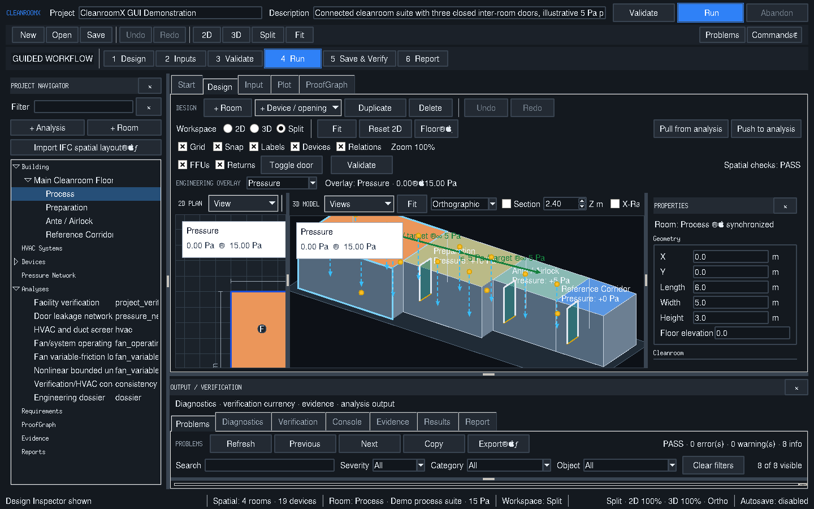

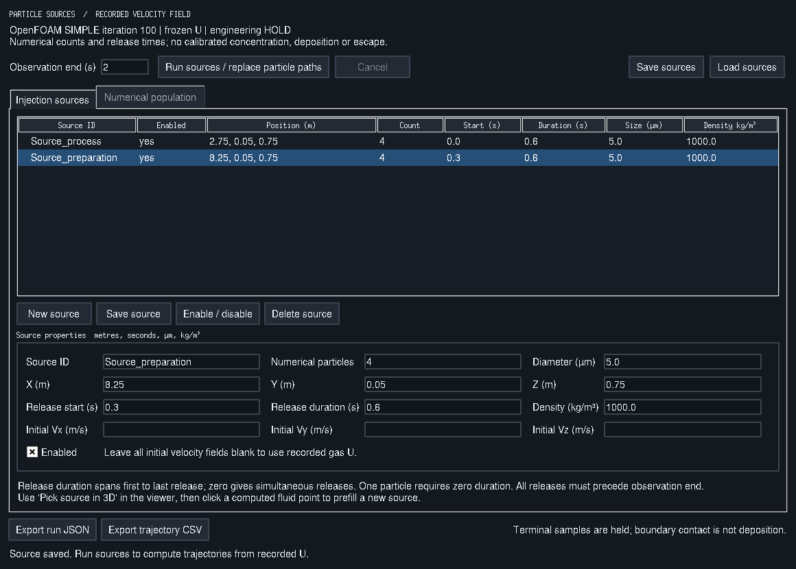

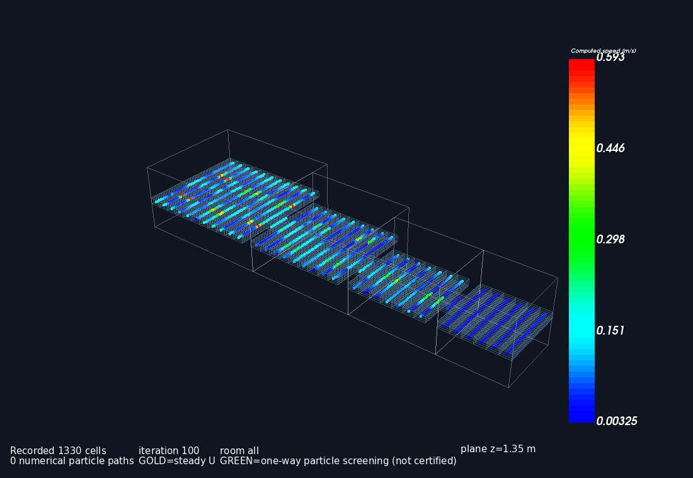

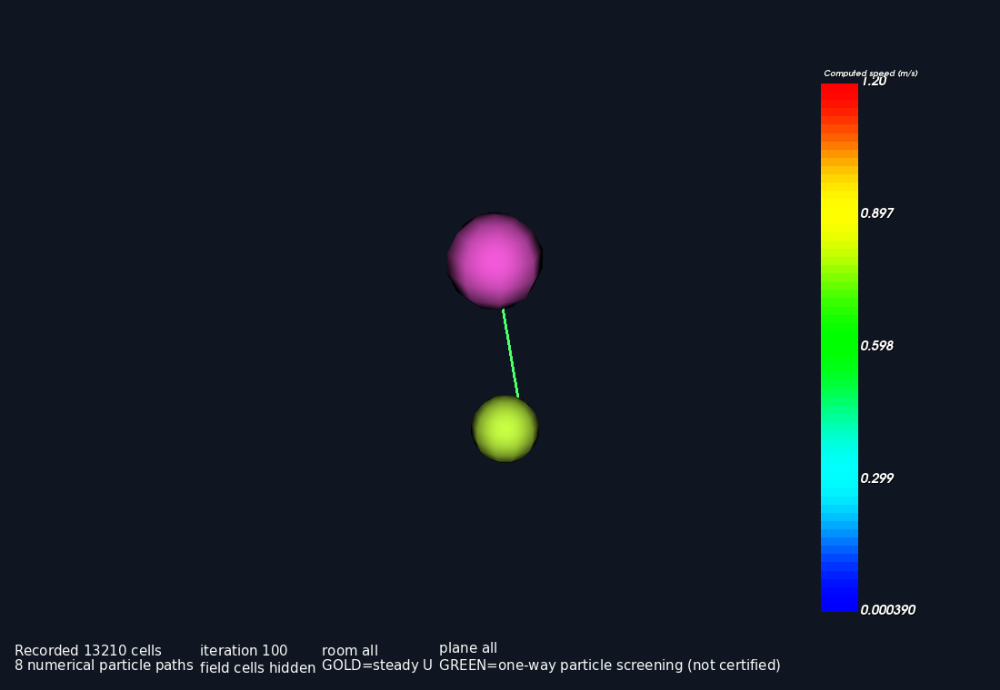

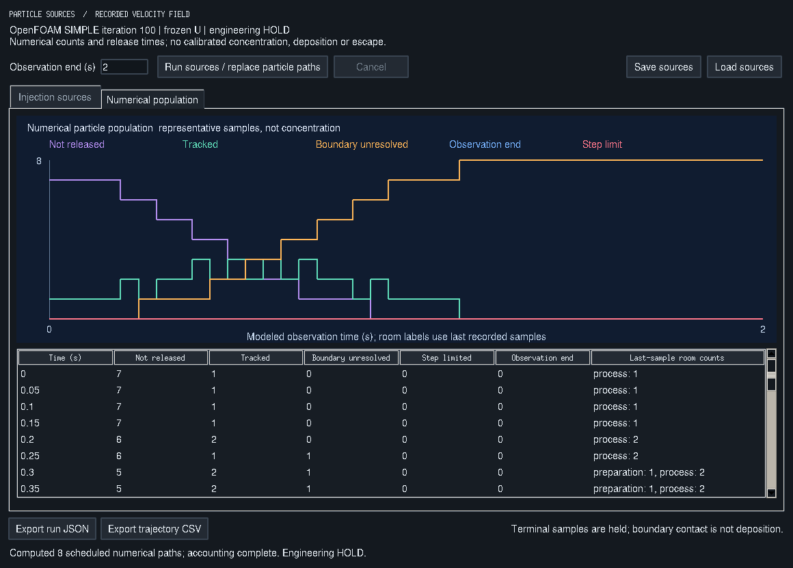

[All actual captures](docs/real-gui-screenshots-20261021/README.md) ·
[Engineering session report](reports/engineering-session-20261021/REPORT.md) ·
[Current project state / remaining work](docs/PROJECT_STATE.md)

### Workstation and package-readiness diagnostics

The [startup and runtime recovery guide](docs/STARTUP_AND_RUNTIME_RECOVERY.md)
covers persistent startup tracebacks, strict real-GUI smoke checks, bounded
OpenFOAM installation discovery and configurable WSL checkout/runtime paths,
including installations accessible under `/mnt/d/`.

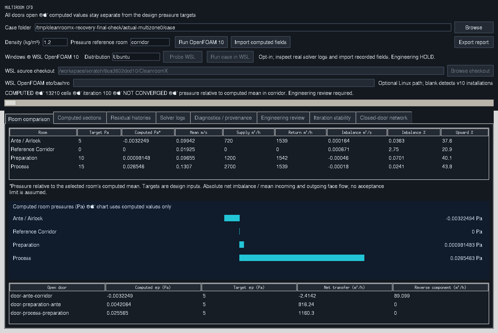

Use `cleanroomx-doctor` to check Python qualification, package and module
integrity, native BIM availability, Tcl/Tk readiness, packaged examples,
plugin/analysis registry integrity, and atomic persistence. Add `--deep` to
exercise a packaged analysis, `--require-desktop` to test an actual display,
or `--require-installed-distribution` for a strict installation audit.
The command supports JSON/text output, support-safe `--redact-paths`,
and `--baseline` with `--fail-on-regression` for CI readiness drift.
See [System Health Doctor](docs/SYSTEM_HEALTH.md) for all options, exit
codes, privacy considerations, and limitations.

## What CleanroomX provides

### 2D + 3D cleanroom design workspace

- One canonical spatial model shared by the synchronized 2D editor and 3D viewer.
- Floors, rooms, dimensions, elevations, classifications, doors, windows, transfer openings, and placed equipment/devices.
- Grid snapping, room movement and resize, viewport controls, fit/reset, 3D orbit, labels, pressure overlays, and pressure-cascade visualization.
- Spatial integrity checks for invalid geometry, overlapping rooms, duplicate names, orphan assignments, and invalid device placement.
- Project-wide transactional Undo/Redo.
- Deterministic spatial editing and no-op suppression to avoid unnecessary history/autosave changes.
- Validated, atomic property edits that keep devices attached when room coordinates change.
- Room/device duplication with fresh IDs, synchronized views, and one-step Undo/Redo.

<!-- cleanroomx-multiroom-cfd-gallery:start -->
## Multiroom CFD — GUI and computed-field screenshots

These are six unedited CleanroomX desktop screenshots. See the [annotated CFD gallery](docs/MULTIROOM_CFD_GALLERY.md) for interpretation and evidence limitations.

**Numerical status:** The 13,210-cell, 600-iteration example is **NOT CONVERGED**. Computed pressures must not be mistaken for achieving 5/10/15 Pa design targets. A separate, lower-flow screenshot selects iteration 50 of a run that later reported convergence at iteration 163. Screenshots are not independent CFD validation.

**2D and 3D cleanroom design workspace**

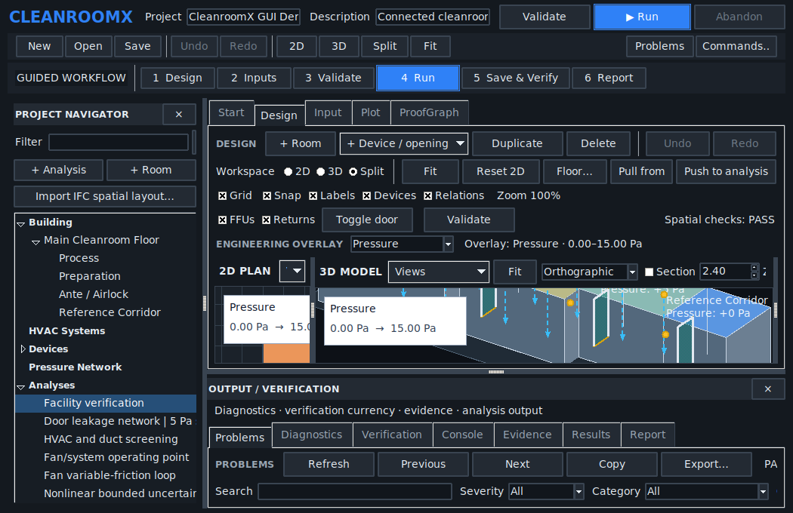

**Computed multiroom CFD dashboard**

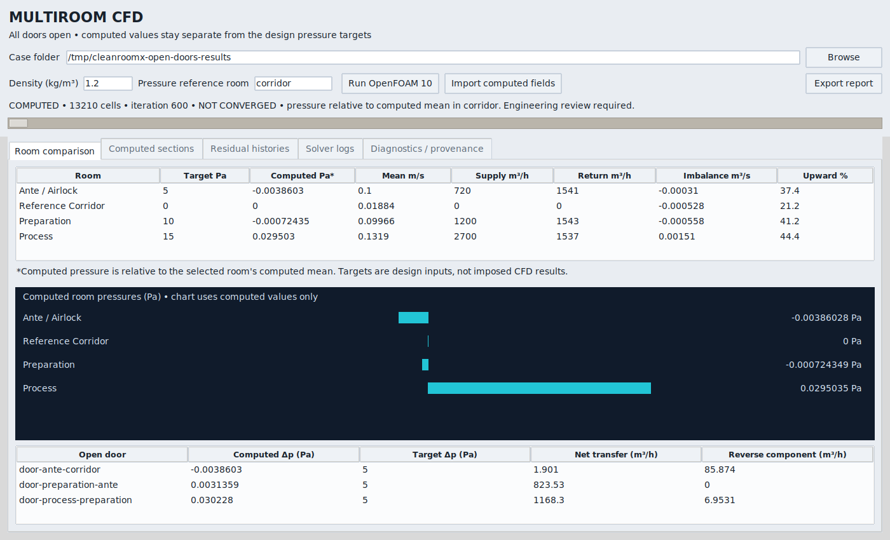

<details>
<summary>View four additional CFD screenshots</summary>

**Computed pressure section and velocity vectors**

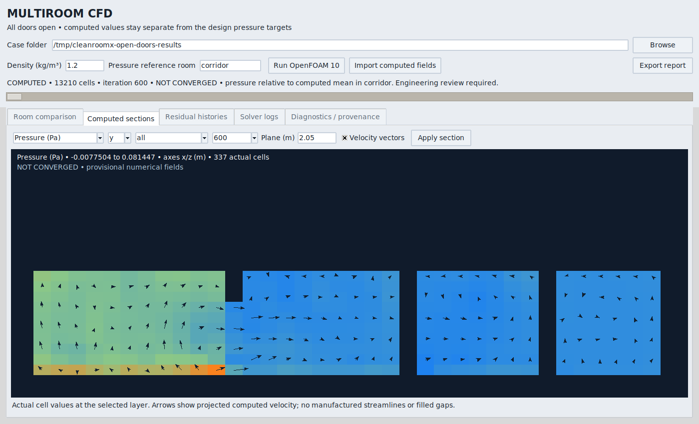

**Room airflow balance and open-door transfer**

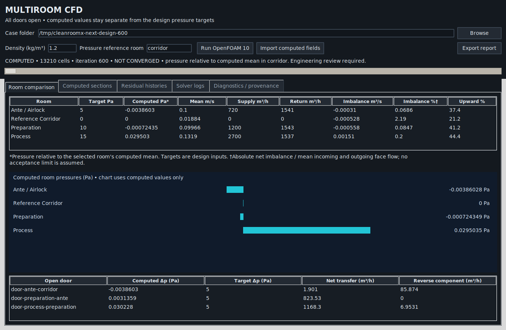

**Residual history — 600-iteration run not converged**

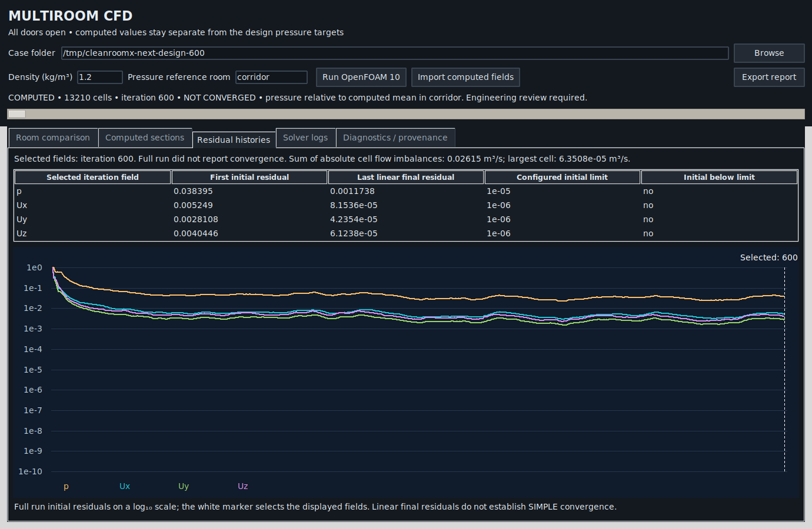

**Earlier snapshot of the separate lower-flow run**

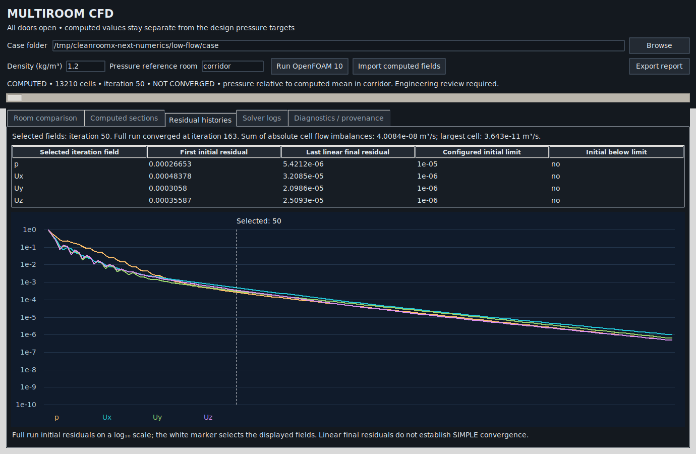

</details>

The six source PNG files and their [SHA-256 manifest](docs/images/multiroom-cfd/manifest.json) are retained under `docs/images/multiroom-cfd/`. Validate their integrity with `python tools/validate_multiroom_cfd_gallery.py`.
<!-- cleanroomx-multiroom-cfd-gallery:end -->

### Cleanroom CFD study (external solver evidence)

- Compare three supply/exhaust layouts: central ceiling / low-wall, distributed ceiling / low-wall, and distributed ceiling / raised perforated floor.
- Post-process externally computed velocity vectors, concentration fields, and solver-labelled recirculation regions with volume weighting and supply/exhaust balance checks.
- Require matching case conditions and explicit project tolerances before comparison; **never infer CFD results from the study handout**.
- This feature is **not an integrated CFD solver**. See [CFD Ventilation Study](docs/CFD_VENTILATION_STUDY.md).

### CFD solver case pipeline (external OpenFOAM)

- Parameterized 3D case generation for all three ventilation layouts, with physically explicit inlet/outlet patches and SHA-256 manifest.
- Opt-in OpenFOAM Foundation v10 laminar flow execution, VTK cell field import, and cross-section previews.
- This is **not a physically validated end-to-end CFD/particle solver**. See [OpenFOAM CFD Pipeline](docs/CFD_OPENFOAM_PIPELINE.md).

### Source-driven CFD passive tracer and numerical audit

- Localized OpenFOAM Foundation v10 passive scalar source by point-selected finite-volume cell (separate scalar case based on computed airflow).
- SHA-256 provenance from airflow U and polyMesh into immutable scalar-case inputs.
- User-thresholded OpenFOAM residual/continuity log screening with fail-closed incomplete evidence; **not** proof of physical convergence or certification.
- [Passive scalar and numerical audit guide](docs/CFD_SCALAR_TRANSPORT_AUDIT.md).

### CFD mesh refinement verification

- Generate nine reproducible OpenFOAM input cases across three ventilation layouts and three mesh resolutions.
- Import real VTK velocity or scalar fields and OpenFOAM residual logs at fine, medium and coarse resolutions.
- Compute apparent order, Richardson zero-grid estimate and fine-grid GCI using user-defined verification criteria; an acceptable GCI is **not** a claim of physically validated CFD.
- See [three-grid convergence workflow](docs/CFD_GRID_CONVERGENCE.md).

### Recorded-field particle sources

- **Computed sections → Open real VTK 3D → Particle sources...** opens the
  functional source table/editor. Pick a solved fluid cell in 3D, save source
  properties, and run the complete collection on a cancellable worker.
- Multiple source definitions with explicit release start, duration, numerical
  count, enablement and initial velocity, driven by recorded OpenFOAM U.
- Reuses the existing one-way Stokes/Cunningham/inertia/gravity screening model.
- Source-bound JSON configuration, cancellable atomic integration,
  release-aware sample playback, numerical population accounting and replayed
  trajectory JSON/CSV export; at most 20 numerical particles per run.
- Counts are numerical samples, not calibrated airborne concentrations.
  Boundary contact does not establish deposition or outlet escape.
- The source review includes computed population graphs/tables, source glyphs,
  JSON save/load, and a release-aware 3D timeline using actual integration samples.
- [Source model and workflow](docs/CFD_PARTICLE_SOURCES.md) ·
  [Current engineering evidence and limitations](docs/PROJECT_STATE.md).

### Engineering verification

CleanroomX includes engineering workflows for:

- room volume and air-change calculations;
- ACH, differential-pressure, and particle-concentration checks;
- multi-room pressure-cascade verification;
- recovery/particle-decay screening;
- psychrometric and thermal calculations;
- supply/return/exhaust/transfer airflow balance;
- preliminary fan duty and power calculations;
- duct pressure-loss analysis;
- branch, fixed-resistance, and looped airflow networks;
- fan/network operating-point solving;
- variable-friction network solving;
- bounded uncertainty and numerical provenance analysis.
- explicit design-requirements ↔ preliminary air-system consistency checks.
- explicit design pressure-target ↔ solved pressure-network node/reference consistency checks.
- versioned compliance rule-pack evidence checks with explicit source/reference traceability and SHA-256 binding for both criteria and supplied evidence revisions.
- design-assurance matrix composition across canonical design consistency, optional explicit pressure-design consistency, and versioned compliance evidence, with tamper-evident component/traceability digests.

#### Strict verification automation

Room and project verification expose both legacy no-failure semantics and strict completed-verification semantics. The default CLI exit code remains backward compatible: exit code 0 means no configured check recorded a failure, even if some evidence is still `not_checked`. For CI, release gates, or engineering automation that must reject incomplete evidence, use:

```bash
cleanroomx verify examples/basic_room.json --require-verified
cleanroomx verify-project examples/facility_project.json --require-verified
```

With `--require-verified`, exit code 0 requires `verified: true`; `pass_with_unchecked`, `not_checked`, and `fail` return exit code 2. The JSON result is unchanged and still includes `status`, `complete`, `verified`, `no_failures_detected`, and the backward-compatible `passed` field.

### Spatial ↔ engineering synchronization

Spatial and engineering data remain deliberately separated.

- Geometry synchronization is **dimension-only**.
- Changes are preflighted before mutation.
- CleanroomX tracks synchronized, geometry-newer, engineering-newer, conflicting, and unmapped states.
- Fresh verification pressure may drive 2D/3D pressure visualization without being written back into spatial geometry.

### Project requirements

- **Verify → Requirements Editor…** creates and edits canonical requirement sets inside CleanroomX.
- Requirements retain explicit source/revision, scope, criterion, units, tolerance, applicability, verification method, and evidence expectations.
- Candidate edits are validated against the complete project before commit, preventing mapped requirements from being silently orphaned.
- Requirement edits participate in project-wide Undo/Redo and feed the existing traceability, verification, ProofGraph, diagnostics, and reporting paths.

### Project constraints

- **Verify → Project Constraints…** provides an in-application Constraint Manager.
- Constraints reuse the versioned compliance rule-pack engine rather than a parallel evaluator.
- Each rule keeps an explicit evidence path, operator, expected value, unit, tolerance, source, and reference.
- Changes are validated transactionally and participate in project-wide Undo/Redo and autosave.
- CleanroomX does not infer regulatory acceptance criteria; project criteria remain explicit user/project data.

### Project integrity and evidence

- Strict JSON ingestion.
- Atomic project/report persistence.
- Autosave and crash-recovery artifacts.
- Saved project revisions and external-write protection.
- Immutable run snapshots and execution provenance.
- Deterministic project batch execution.
- Project-wide read-only design/model diagnostics with spatial, synchronization, input-validity, and stale-evidence checks.
- Portable project bundles and engineering reports.
- Deterministic self-verifying design-assurance snapshots that bind exact source bytes, normalized results, optional pressure-design evidence, and traceability digests.
- SHA-256 based numerical/provenance evidence for supported solver workflows.

## Quick start

### Windows — repository checkout

From PowerShell:

```powershell
cd C:\CleanroomX
.\start-cleanroomx.ps1
```

CMD is also supported:

```cmd
start-cleanroomx.cmd
```

Run the installation/readiness check:

```powershell
.\start-cleanroomx.ps1 --check
```

### Python installation

CleanroomX supports **Python 3.11, 3.12, and 3.13**.

```bash
python -m venv .venv
python -m pip install -e .
cleanroomx-gui
```

Open the packaged demonstration:

```bash
cleanroomx-gui --demo
```

Headless readiness check:

```bash
cleanroomx-gui --check
```

## Main command-line tools

Run a saved project:

```bash
cleanroomx-project-run project.cleanroomx.json
```

Create or verify portable project evidence:

```bash
cleanroomx-project-bundle --help
```

Freeze and independently replay design-assurance evidence:

```bash
cleanroomx-assurance-snapshot create examples/design_assurance_demo.json design_assurance.snapshot.json
cleanroomx-assurance-snapshot verify design_assurance.snapshot.json
```

See [Design Assurance Snapshots](docs/ASSURANCE_SNAPSHOTS.md) for schema, integrity, replay, and security boundaries.

Run a project-wide model/provenance health check:

```bash
cleanroomx-project-check project.cleanroomx.json
```

See [Project Diagnostics](docs/PROJECT_DIAGNOSTICS.md) for rule scope, severity, freshness behavior, and exit codes.

Other installed CLIs cover HVAC, qualification, duct flow, loop networks, fan/network studies, uncertainty, consistency checks, and engineering dossiers.

## Validation

The **v0.102.1** release closure was validated across Python **3.11 / 3.12 / 3.13**.

Recorded release evidence includes:

- **1008 passing tests** on each supported Python version for the final deterministic-spatial-drag release gate;
- Windows PowerShell and CMD launcher smoke tests;
- clean wheel build/install checks;
- installed Tk GUI smoke testing;
- synchronized 2D/3D spatial regression coverage;
- autosave completion-race regression coverage;
- solver/provenance compatibility gates.

The exact release evidence is preserved in:

- [VALIDATION.txt](VALIDATION.txt)
- [TEST_EVIDENCE.md](TEST_EVIDENCE.md)
- [CHANGELOG.md](CHANGELOG.md)

## Engineering boundary

CleanroomX provides **engineering screening, simulation, verification, and software/provenance evidence**.

It does **not**, by itself, establish cleanroom certification, CFD validation, commissioning/TAB acceptance, manufacturer approval, or regulatory compliance.

## Documentation

- [Professional Engineering User & Validation Manual (PDF)](docs/CleanroomX_Complete_Solution_Manual_2026-09-30.pdf)
- [Professional manual source (Markdown)](docs/CleanroomX_Complete_Solution_Manual_2026-09-30.md)

- [Application & GUI](docs/APPLICATION_GUI.md)
- [2D + 3D spatial workspace](docs/LAYOUT_2D_3D.md)
- [Architecture](ARCHITECTURE.md)
- [Design assurance matrix](docs/DESIGN_ASSURANCE.md)
- [Design assurance snapshots](docs/ASSURANCE_SNAPSHOTS.md)
- [Pressure design consistency](docs/PRESSURE_DESIGN_CONSISTENCY.md)
- [Deployment](DEPLOYMENT.md)
- [Migration notes](MIGRATIONS.md)
- [Security](SECURITY.md)
- [Rollback](ROLLBACK.md)
- [Changelog](CHANGELOG.md)

## Release

**Latest stable:** [CleanroomX v0.102.1](https://github.com/3more102/CleanroomX-Cleanroom-Design-Simulation-Verification-Platform/releases/tag/v0.102.1)
