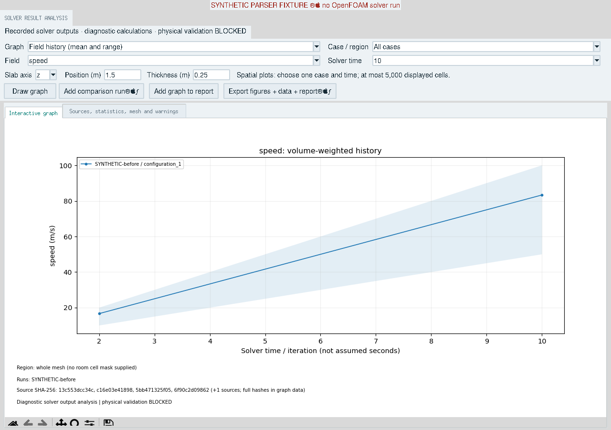
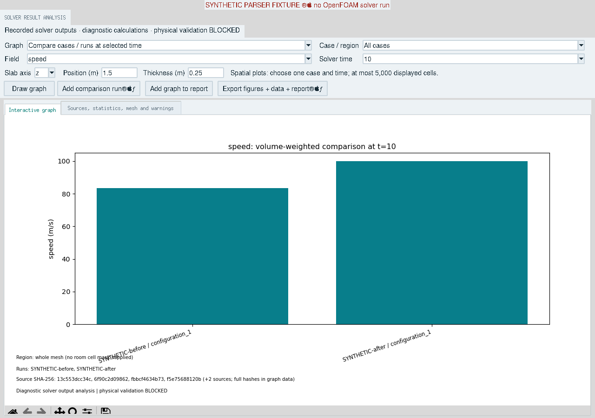
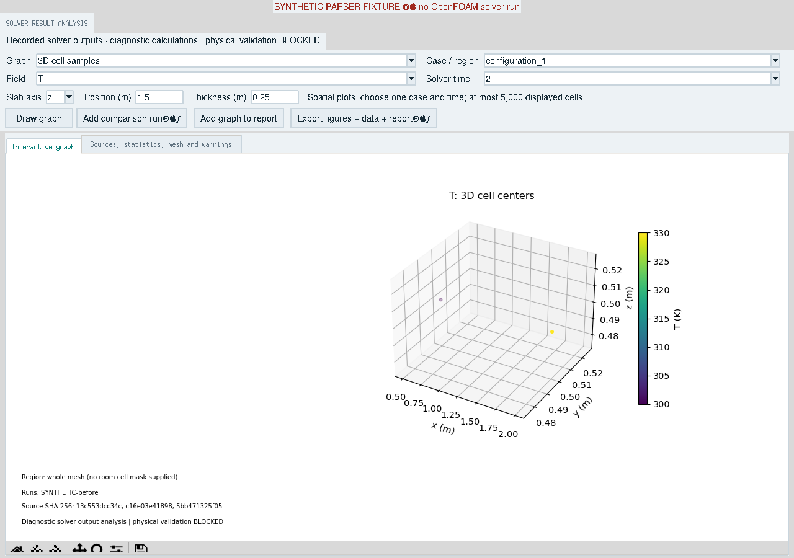
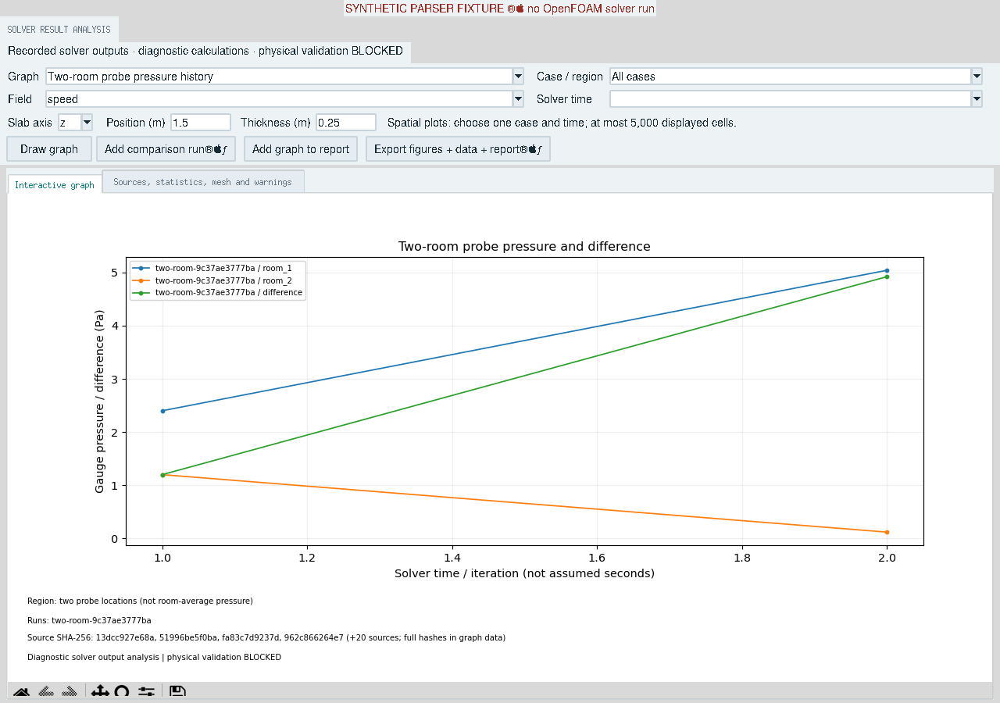
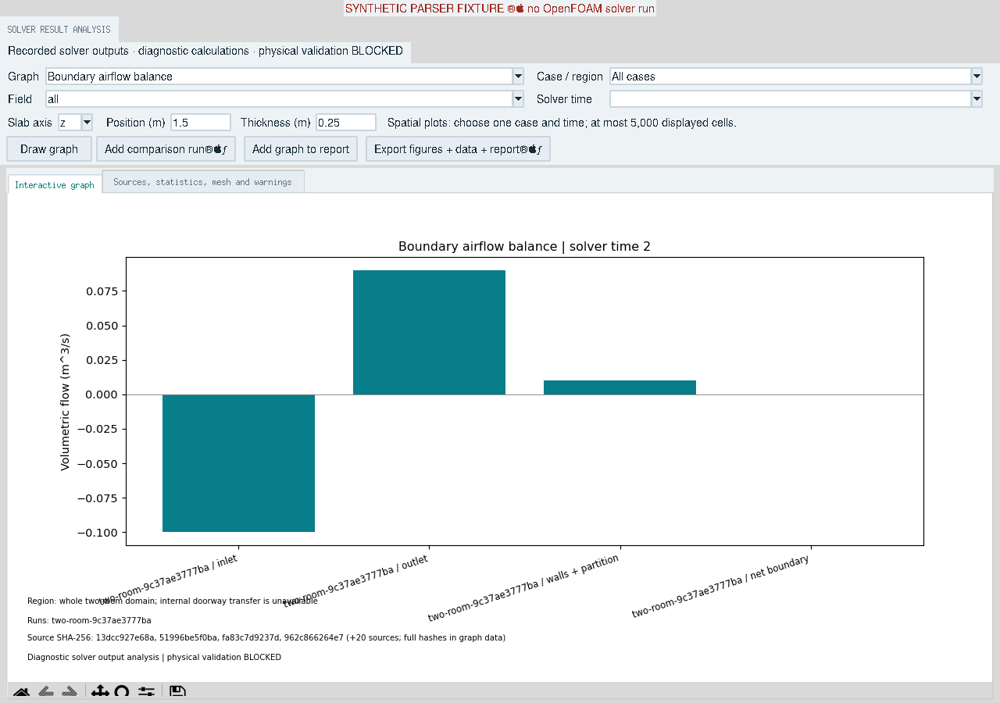
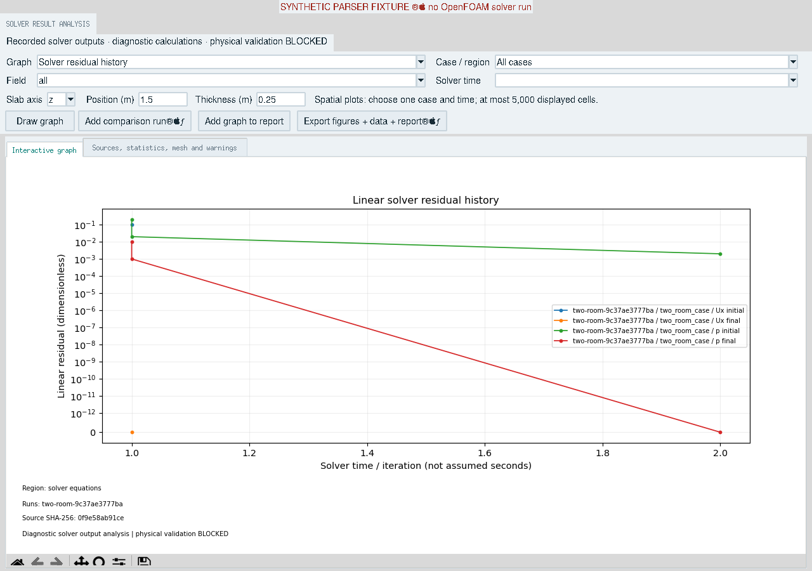

# Solver-result analysis and graphing

The analysis explorer post-processes recorded OpenFOAM outputs. It never starts
a solver, substitutes prescribed inlet flow for solved `phi`, or fills missing
temperature/scalar fields with illustrative values. Scientific validation stays
`BLOCKED`; graph generation adds no convergence acceptance verdict.

## Inspected workflow and changes

This work continues the active two-room integration head `669474f` (PR #1326),
which contains the runtime synchronization and ProofGraph stack. The default
`main` head at inspection was `cf5506f`. Existing unmerged work was retained.

| Stage | Existing implementation | Completed improvement / remaining boundary |
|---|---|---|
| Setup | `cfd_openfoam.export_openfoam_cases`; `cfd_two_room.export_two_room_case` | Reused unchanged generation and input audits; bounded synthetic laminar cases remain the supported generators. |
| Execution | Foundation-v10 runners, persisted stage logs, runtime sync, two-room receipt | Added an optional final solver-log SHA-256 to native sync manifests; process success remains separate from convergence. |
| Parsing | `cfd_vtk.import_vtk_case`, native/VTK parity, explicit native dimensions | Reused cell-volume calculation and bounded importer; analysis requires native cell-data U and refuses point interpolation. |
| Analysis | External three-case study calculations and final two-room diagnostics | Added all-cell, volume-weighted field statistics and full probe/linear-solve histories; reparses two-room phi rather than copying receipt metric values. |
| Graphs | Static three-panel CLI cell-slab plot; computed fan GUI plots | Added an asynchronous Tk explorer with a shared Matplotlib renderer, exact-time comparisons, cell slabs/3D samples, pressure/flux/ACH/residual graphs. |
| Reports / evidence | Existing result-sync and two-room ProofGraph adapters | Extended the verified base graph with analysis inputs, graph selections, actual point data, export hashes and post-processing execution metadata. |

## Analyses and data requirements

| Analysis / graph | Required source | Units and interpretation |
|---|---|---|
| Field history and run comparison | Native runtime-sync schema v2; verified internal VTK U and positive cell volumes | Speed is mean **of magnitudes**, weighted by cell volume; it is not magnitude of the mean velocity. Field histories include all-cell min/max. |
| Kinematic pressure | Recorded native p dimensions `[0 2 -2 0 0 0 0]` and the matching VTK array | `m^2/s^2`; never relabeled Pa in the field explorer. |
| Temperature | Recorded T dimensions `[0 0 0 1 0 0 0]`, positive kelvin values | K. A dimensionless passive-scalar T retains its native label/dimensions. |
| Other solved scalar/vector components | Recorded field metadata with explicit units and matching VTK cell arrays | Native name/units retained; vector components have separate identities. No array name alone establishes contaminant concentration. |
| Spatial slab / 3D samples | One selected case and solver time | Cell-center samples in metres; no interpolation, contour reconstruction or streamline integration. |
| Room pressure history | Completed two-room v2 receipt and probe p file | Gauge probe pressures and room-1 minus room-2 difference in Pa, using the **declared** case density. Probes are not room-volume averages. Initial/nonpositive-time samples are excluded. |
| Airflow balance | Completed two-room receipt; native final-time volumetric phi and polyMesh boundary | m³/s, outward positive. Includes inlet, outlet, walls/partition and net boundary flux. No project acceptance percentage is invented. |
| Inlet supply ACH | Same phi plus total mesh volume in checkMesh output | `3600 * gross inlet flow / mesh volume`, in h⁻¹. Whole two-room domain only; not per-room or outdoor-air ACH. |
| Linear residual history | Native simpleFoam.log; matching case inputs; optional recorded solver-log hash | Initial/final residuals, repeated pressure correctors and zero values retained. Symlog displays zeros without replacing them. Legacy logs show an unverified run link. |
| Mesh quality / warnings | Native checkMesh.log | Existing parser reports geometry, checks, missing/invalid fields and warnings in the details tab/report. No new quality threshold is imposed. |

Field history: `sum(V_i * value_i) / sum(V_i)`, over every imported cell.
Comparison: equal numeric solver time only; no interpolation and no substitution
of another run's latest output. Missing cases, fields or requested times produce
no fabricated bar. This is a descriptive comparison; it does not establish that
boundary conditions, pressure references or physical scenarios are equivalent.
Review those before drawing an engineering conclusion.

The field explorer supports the existing three-configuration native runtime-sync
layout, `<store>/<simulation-id>/configuration_N/sync_manifest.json`, standalone
`sync-case` output directories containing `sync_manifest.json`, and the separate
two-room v2 receipt workflow. Standalone native stores retain the manifest's
original case/region identifier, including nested identifiers; the output
directory can have a different name. Both native layouts use the same strict
manifest, receipt, VTK asset and simulation-identity verification. An explicitly
present malformed standalone manifest fails loading rather than falling back
to another layout. Standalone `sync-vtk` v3 snapshot stores, room cell masks and
per-room boundary flux assignment are not yet imported by this explorer. Missing
per-room ACH/doorway transfer and contaminant acceptance are explicitly recorded
as unavailable. Existing scalar transport execution remains in its current
workflow; this change does not add particle tracking or concentration criteria.

## GUI workflow

1. In **OpenFOAM**, enter the native result store and simulation ID. For a
   standalone `sync-case` export, select the directory that directly contains
   `sync_manifest.json` and use its declared simulation ID. Leave the case
   directory blank for fields only; select the matching native case (standalone)
   or case bundle (three configurations) to inspect logs. Static inputs must
   match the recorded configuration hash; recorded log hashes are rechecked.
2. Select **Analyze / graph results…**. For a two-room run, enter the case and
   existing receipt directories in that panel and select **Analyze results…**.
3. Select the graph, field, case and time, then **Draw graph**. Residual history
   uses field **all** or a specific solver equation such as p/Ux.
4. Use the Matplotlib toolbar for pan, zoom, reset and save. Rotate 3D samples
   with the mouse. Set slab axis/position/thickness for 2D selection.
5. **Add comparison run…** selects another simulation directory inside a result
   store or a standalone native store. The latter's run ID is read from its
   verified manifest. Comparison bars use the exact selected solver time.
6. Inspect **Sources, statistics, mesh and warnings**. Each snapshot records
   case/region, raw solver time, import/execution status, native field hash
   metadata, selected VTK source and receipt hashes.
7. Add desired graphs to the report, then export to a new directory outside
   the source case and result stores. The current graph is included as well.

Loading/parsing/export run in workers; Tk callbacks and drawing stay on the
UI thread. Inputs are bounded to 256 snapshots per analysis and the existing
VTK limits (100,000 cells and 256 MiB per dataset). Spatial display uses at most
5,000 deterministic samples, while calculations use all cells. Long histories
retain endpoints and bucket minima/maxima for display; complete parsed linear
solves remain in JSON/CSV. Requested data beyond resource limits fails clearly.

## CLI

With VTK and Matplotlib installed (`pip install '.[cfd]'` in a checkout):

```bash
cleanroomx-cfd-pipeline analyze-results ./native_results \
  --simulation-id run-before --case-directory ./case_bundle \
  --comparison-simulation-id run-after --field speed --time 100 \
  --output ./analysis_comparison

cleanroomx-cfd-pipeline analyze-results ./standalone-sync-output \
  --simulation-id my-native-run --case-directory ./my-native-case \
  --field speed --output ./standalone-analysis

cleanroomx-cfd-pipeline two-room-analyze \
  ./two_room_case ./two_room_receipt/two_room_run_receipt.json \
  --output ./two_room_analysis
```

These commands consume existing results and do not require an installed solver
at post-processing time. `--case-directory` is optional; legacy unbound native
logs remain clearly marked in graph series and exported CSV.

## Export and reproducibility

| File | Contents |
|---|---|
| `analysis.json` | All computed field summaries, execution metadata, full parsed residuals, pressure histories, mesh diagnostics, availability states, methods and source hashes. |
| `graphs.json`, `graphs.csv` | Exact displayed graph data, units, run/case/region, solver times, field/slice filters and source paths/digests. |
| `residuals.csv` | Every parsed linear solve before display reduction, including line number, initial/final values, linear iterations and log-to-run binding. |
| `cell-data-NN.csv` | Every spatially selected cell before display sampling, with cell-array index, coordinates, time, value and source digests. |
| `figure-NN.png`, `figure-NN.svg` | Shared-renderer figures with labels, run/region and source hash references. |
| `report.md` | Field tables, mesh/warning and availability details, calculation methods and figures. |
| `proofgraph-NN.json` | Original verified result evidence extended with the derived analysis/graphs and export SHA-256 links. Integrity pass remains artifact-only; physical validation stays not checked. |
| `manifest.json` | SHA-256 of every exported artifact except the manifest itself. |

Exports recheck all bound source files before and after rendering, reject edited
graph data, refuse existing output directories, and stage publication so an
error does not leave a partial deliverable. Sources are referenced by path/hash;
the bundle does not copy the full solver case. Retain that case/result store
for replay. Paths may be machine-specific; this is an engineering export, not a
redacted public report. Hash consistency is not a signature or authenticity
proof. Native source-field bytes in runtime sync are still represented by their
recorded hash metadata, not independently rehashed by this post-processor.

## Verification and genuine GUI screenshots

`tests/test_cfd_sync_case_analysis.py` additionally exercises standalone named
cases, nested identifiers, input/log binding, invalid identities, receipt/asset
tampering, GUI folder-selection loading, CLI export and close solver times that
round to the same floating-point number. Spatial export selection and raw CSV
time values retain the exact source decimal time; spatial coordinates remain
coordinates in metres.

`tests/test_cfd_result_analysis.py` exercises unequal-volume weighting, numeric
time matching, missing fields, dimensionless T, source tampering, pressure/phi
parsing, ACH, exact zero residuals, exports, full selected-cell CSV, cleanup and
ProofGraph round trips. `tests/test_gui_cfd_analysis.py` drives actual Tk widgets
and asynchronous graph loading when a display is available.

The following captures were preserved from the earlier analysis checkpoint;
they have not been recaptured for the standalone-store update. They show the
actual Tk explorer, with the explicit
**SYNTHETIC PARSER FIXTURE - no OpenFOAM solver run** banner. They demonstrate
the UI and parsing calculations only. They do not represent new solver runs,
cleanroom measurements or scientific validation. Reproduce with:

```bash
xvfb-run -a python tools/capture_cfd_analysis_screenshots.py
```








The screenshot manifest records file dimensions, SHA-256 digests and fixture
provenance. OpenFOAM was unavailable in the implementation environment; tests
and captures use reproducible fixture files, with no live solver claim.
