# CleanroomX — Illustrated GUI Manual (Real Windows Screenshots)

**Document:** CX-GUI-IMG-2026-10-17  
**Issue date:** 17 October 2026  
**Type:** Screenshot companion to the controlled [engineering user manual](CleanroomX_Complete_Solution_Manual_2026-09-30.md).  
**PDF edition:** [Download the 20-page illustrated PDF](CleanroomX_Illustrated_GUI_Manual_2026-10-17.pdf) (the binary PDF is published with the screenshot package).  
**Interactive gallery:** [Open the GUI gallery](screenshots/gallery.html).

> **Engineering boundary:** These are desktop-interface illustrations from the user-supplied running CleanroomX GUI. They do **not** prove OpenFOAM convergence, particle performance, measured cleanroom behavior, or verified scientific CFD. The fan/system example is a genuine numerical demonstration, not CFD. The image audit identified **18 PNGs but only 13 distinct SHA-256 hashes**. Do not use filenames as proof of what a screenshot actually depicts.

## 1. Start a project

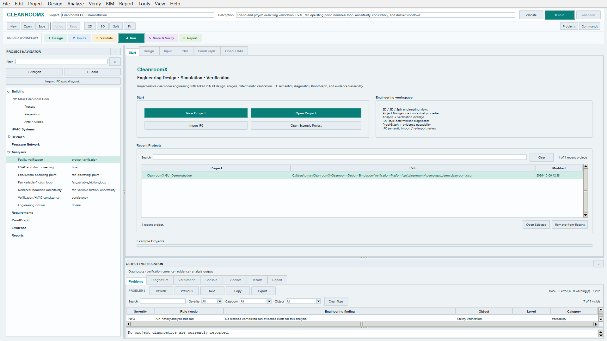

Use the **Start** tab to open a project, create a new one, select the bundled demonstration project, or review recent projects. Project Navigator and Output / Verification provide context and diagnostics. Review the displayed project and active analysis before editing or running.

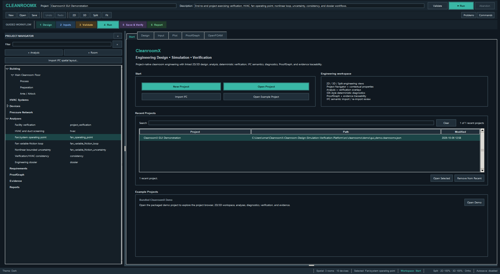

The dark palette is a presentation preference; it does not change solver inputs or evidence.

## 2. Understand the full design workspace

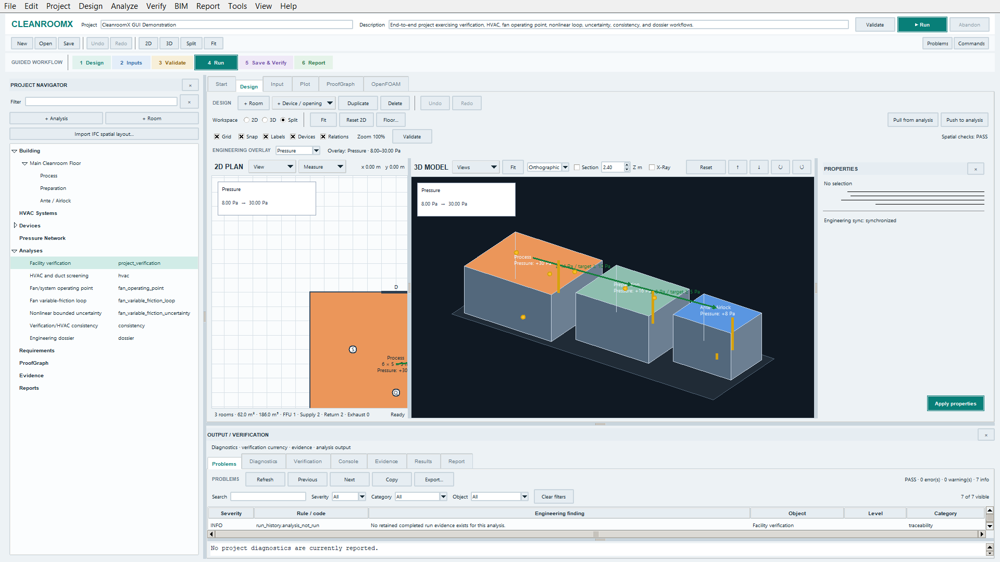

In the complete workspace, **Project Navigator** lists the building and analyses, **Design** displays 2D and 3D, **Properties** shows selected-object details, and **Output / Verification** holds diagnostics and results. A visible “spatial checks: PASS” applies to spatial checks only.

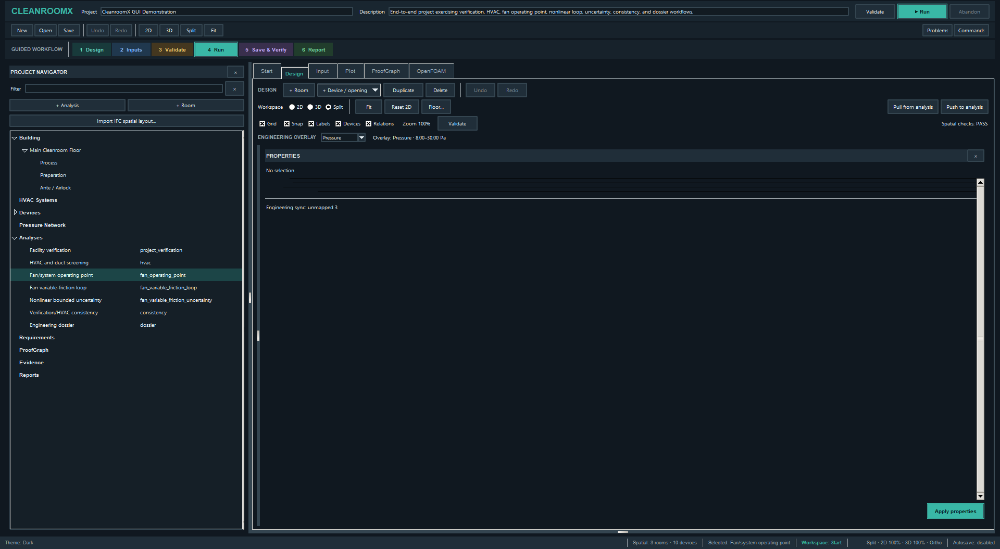

If engineering synchronization reads **unmapped**, verify the mapping rather than treating the scene as fully coordinated.

## 3. Inspect the 2D plan

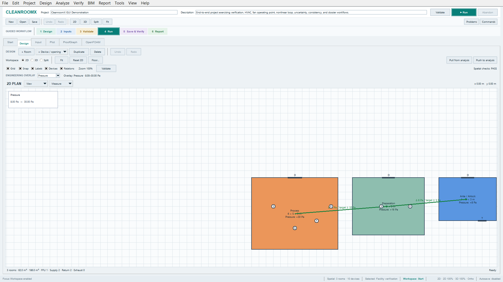

Use the 2D workspace to inspect room outlines, doors, placed devices, labels and the pressure overlay. The supplied screenshot shows three bundled example rooms; its arrows illustrate configured pressure relationships, not simulated air velocity.

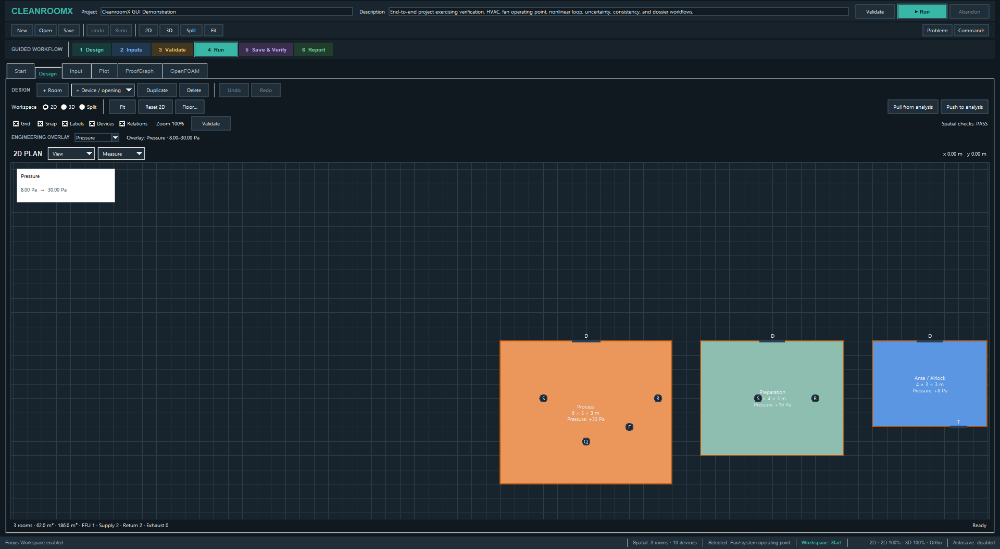

Use Fit / Reset 2D to navigate. Check room dimensions and related engineering analysis inputs before making a design decision.

## 4. Inspect the 3D model

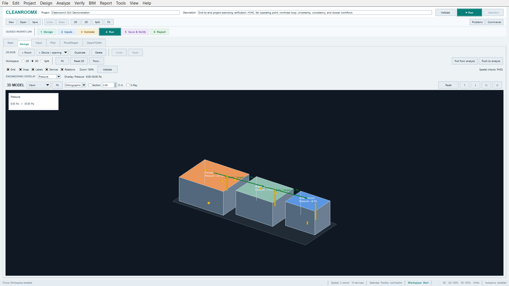

The 3D viewport displays room geometry and device/pressure annotations. Use it for spatial checks; the model's rendered colors are **not** OpenFOAM scalar-field results.

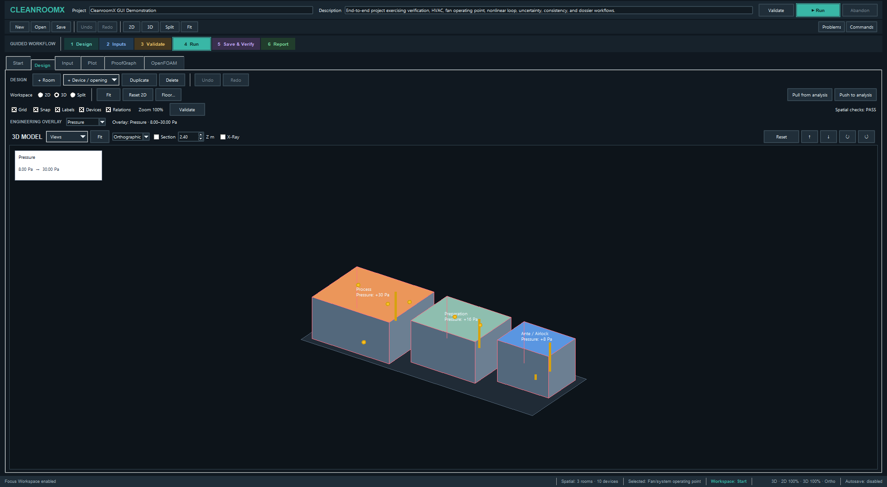

## 5. Compare both views

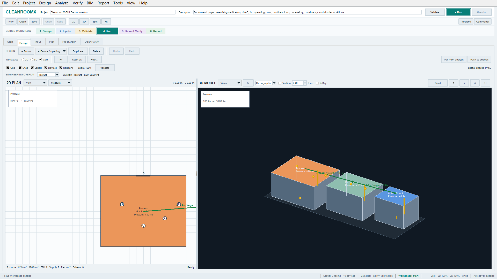

Split mode supports side-by-side review of the plan and spatial model. Confirm room adjacency and placement before syncing with the engineering analysis.

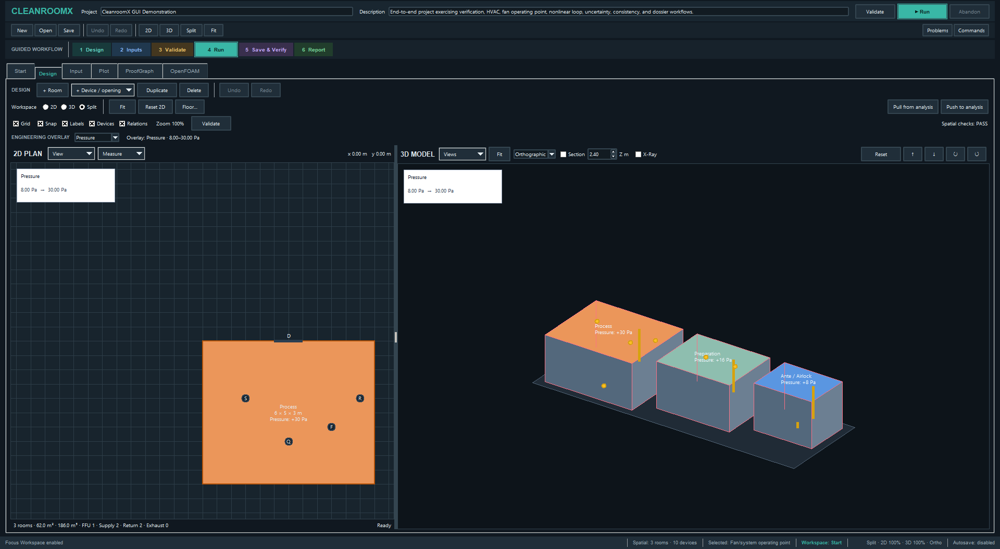

Focus Workspace hides supporting panels for a presentation view; restore those panels when reviewing metadata and diagnostics.

## 6. Select inputs and review numerical results

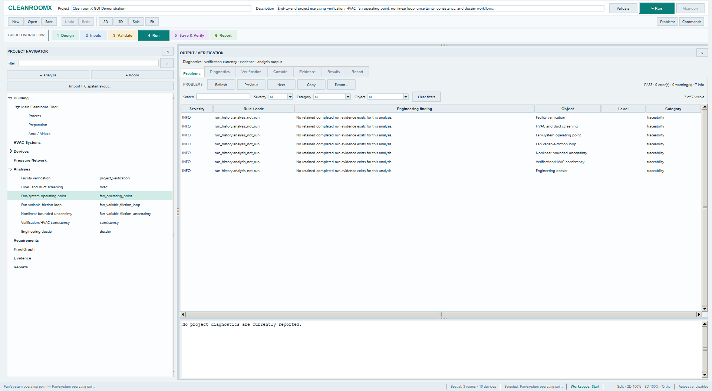

Although this file's name contains *analysis-inputs*, the provided pixels show **results or analysis-related output**, not an editable Input form. Select the **Input** tab to inspect boundary conditions and numeric parameters. The selected analysis in the navigator is **Fan/system operating point**.

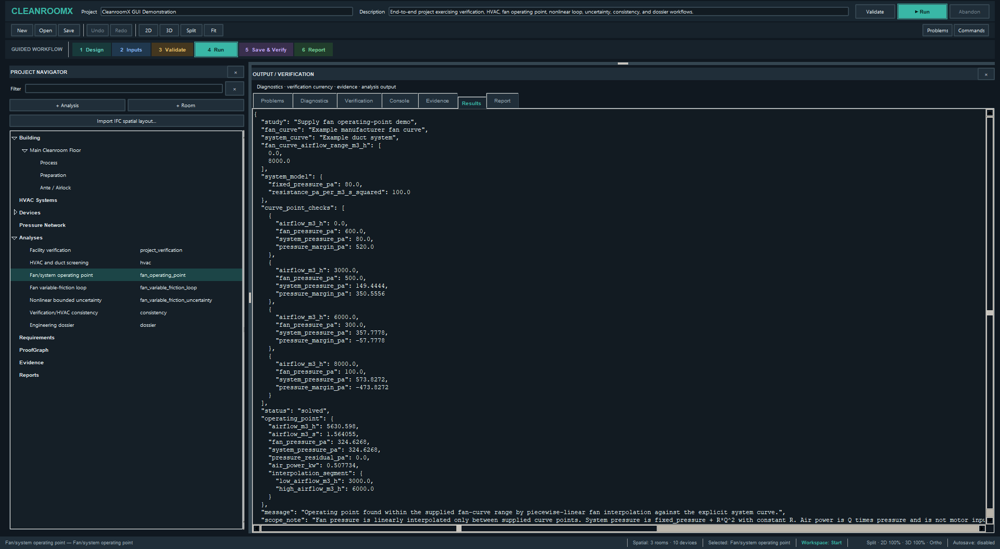

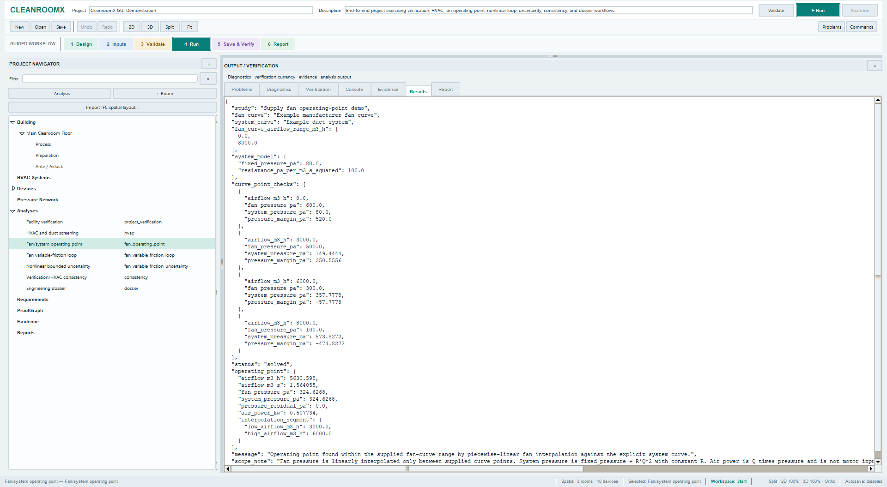

The backend provides a computed fan/system operating-point example. The uploaded image shows **JSON numeric results**, **not a plotted curve**. For the actual graph, use the **Plot** tab and verify the input set and run record.

## 7. Missing screenshots — OpenFOAM and ProofGraph

The following supplied PNG files are **not evidence of their named workspaces**:

- `gui-openfoam-workbench.png` and `gui-openfoam-workbench-dark.png`
- `gui-openfoam-proofgraph-diagnostic.png` and `gui-openfoam-proofgraph-diagnostic-dark.png`

Their pixels repeat the fan Results screenshot. Do not label them as proof of an OpenFOAM simulation or ProofGraph provenance interface. The PDF edition documents this limitation and the publication package retains every source PNG for auditability. To complete these figures, select the actual **OpenFOAM** and **ProofGraph** tabs and capture distinct visible screens after loading appropriate evidence.

## 8. Recommended operator sequence

1. Open the bundled project and check the project navigator.
2. Review 2D / 3D geometry and the room-pressure overlay.
3. Inspect explicit analysis inputs and their units.
4. Run the selected backend analysis and review numeric Results and Plot.
5. Check diagnostics, provenance and evidence currency.
6. Report CFD convergence or engineering acceptance **only** when supported by separate verified solver and qualification evidence.

## 9. Screenshot integrity and publication

The original uploaded image set comprises 18 PNG files and 13 unique SHA-256 digests. Sizes vary between **1920 × 1080** and **1920 × 1055**, as recorded in the companion [source manifest](screenshots/CleanroomX_Illustrated_GUI_Screenshot_Manifest_2026-10-17.json). Images were not upscaled or retouched. The 20-page PDF includes all distinct GUI imagery with explicit limitations.

To publish all images and the PDF from the downloadable artifact package, run the included `publish_cleanroomx_illustrated_manual.ps1` from the extracted ZIP. This publishes the binaries to the current screenshot documentation branch, after which the figure links above resolve to the corresponding reviewed sources.
