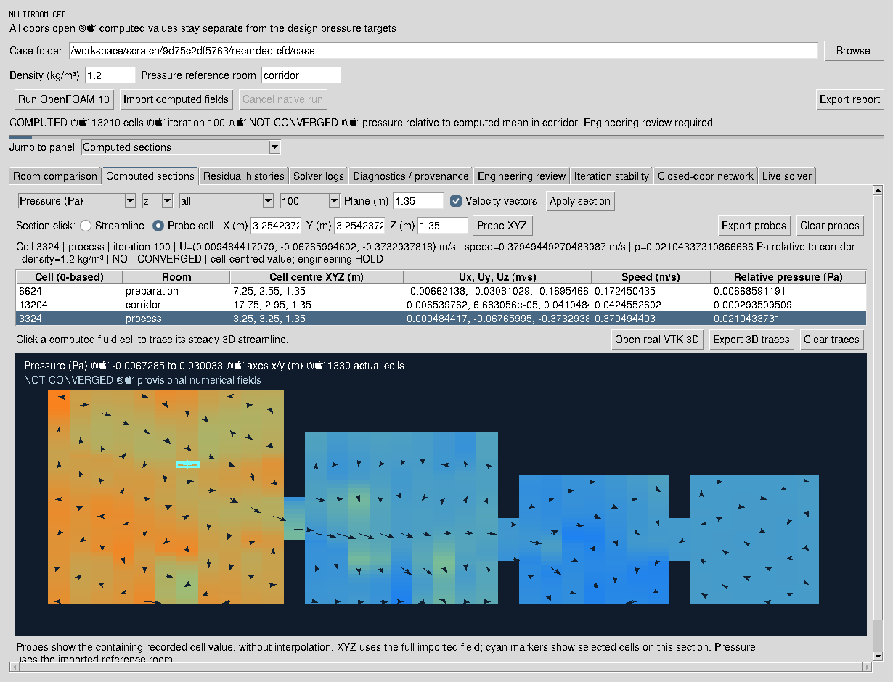

# Actual recorded-field probe UI — 22 October 2026

This is an actual 1230 × 940 Tk window over the original hash-checked
13,210-cell case, at saved SIMPLE iteration 100. The screenshot includes the
real canvas click selection, full pressure/velocity readout, measurement table
and cyan marker. It is a replay of archived fields; **no new solver was run**.
The source case did not report convergence. Engineering release remains HOLD.

[capture-manifest.json](capture-manifest.json) records the source identities,
selected cell values, image and implementation hashes, and zero GUI callback
errors. The [capture script](../../scripts/capture_cell_probe_gui.py) reimports
the case through the canonical receipt/input/log/field checks before capture.
See [probe usage and sampling definition](../CFD_CELL_PROBES.md).
