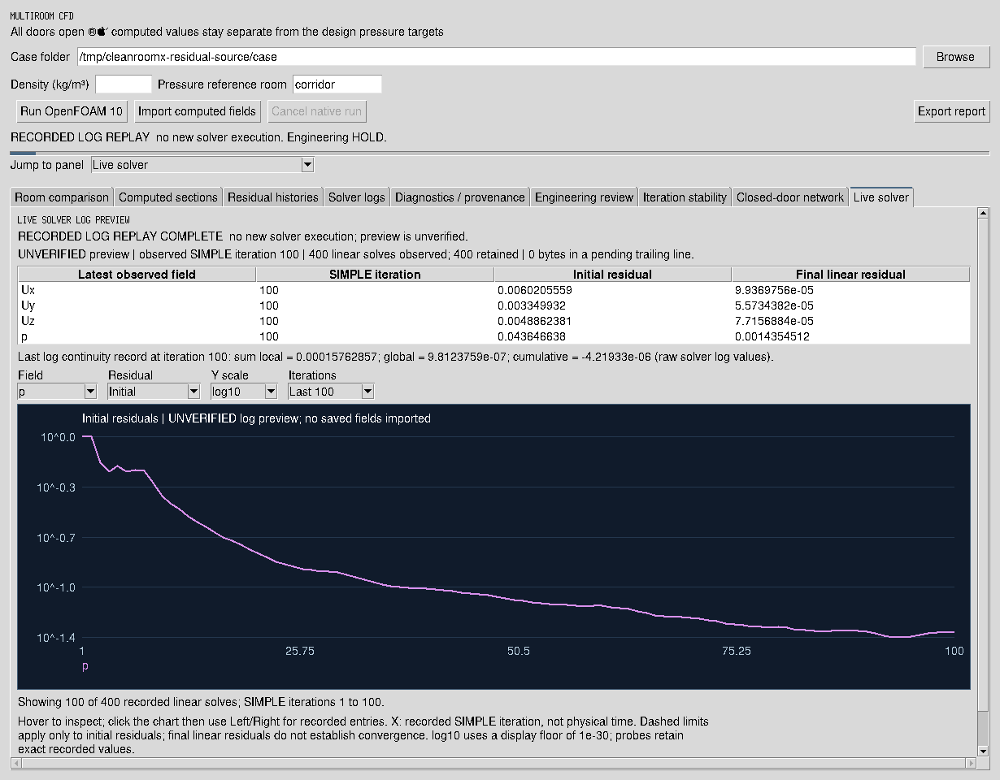

# Live solver preview — 21 October 2026



These are actual pixels from the running Tk application on Xvfb. The UI
explicitly labels this capture **RECORDED LOG REPLAY**, with no new solver
execution. It reads the original [archived case](../../reports/engineering-session-20261021/reproduction-case.tar.gz):
13,210 cells, iteration 100 and 400 original residual entries. The canonical
importer first verified the archived source; the preview's parsed residual
history matched the canonical result exactly. This original run was
**unconverged**.

The preview publishes no computed fields, saved-field marker or convergence
verdict. The [capture manifest](capture-manifest.json) records original case,
implementation and image hashes, exact displayed counts and zero Tk callback
errors. [Usage and limits](../LIVE_CFD_MONITOR.md) describe native/WSL monitoring.

Reproduce with a real display and a new output directory:

```bash
PYTHONPATH=src python scripts/capture_live_solver_preview.py \
  /path/to/extracted/case /path/to/new-capture-directory
```

The [verification report](../../reports/live-solver-monitor-20261021/REPORT.md)
distinguishes executed software/GUI tests from unavailable new solver tests.
**Engineering release remains HOLD.**
