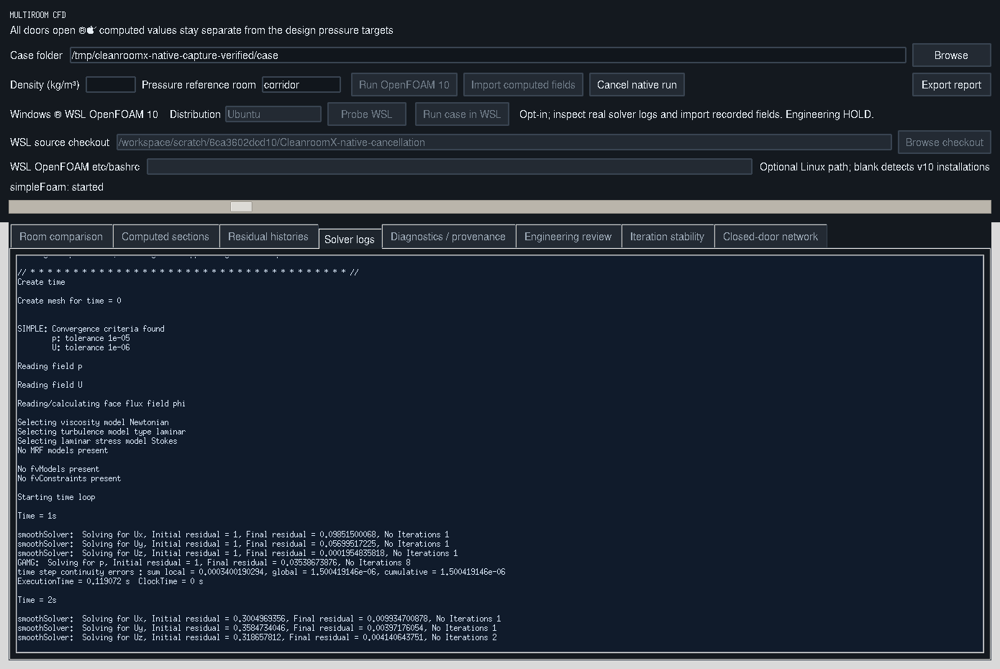
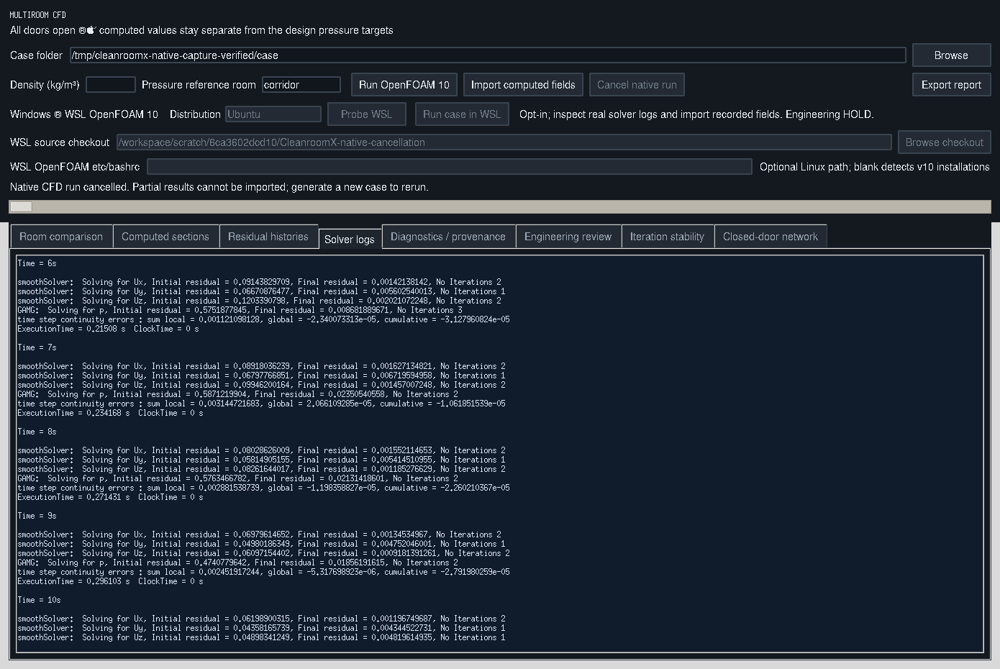

# Actual native solver cancellation

These are original window pixels from `capture_native_cancellation_gui.py`
running the current Tk controls against real Foundation v10. The source case
was generated separately from the successful 100-iteration case retained in
the recovery report.

The capture script waited for the actual `simpleFoam` iteration loop, invoked
the real cancellation button, checked the solver PID no longer existed and
confirmed the canonical field importer rejected the cancelled receipt.
The manifest records two images and zero GUI callback errors.

[Capture manifest and image/source hashes](capture-manifest.json) ·
[Actual run receipt](run-receipt.json) · [Source manifest](source-manifest.json)

Original logs are losslessly compressed: [blockMesh](blockMesh.log.gz),
[checkMesh](checkMesh.log.gz), [simpleFoam](simpleFoam.log.gz).
The receipt and `raw_source_sha256` refer to original uncompressed bytes;
`evidence_sha256` identifies the retained compressed artifacts.

No cancelled output is presented as a completed CFD solution. These Linux/Tk
captures retain the display's font-rendering limitations. They do not qualify
Windows-to-WSL cancellation or physical CFD accuracy. Engineering release is **HOLD**.
