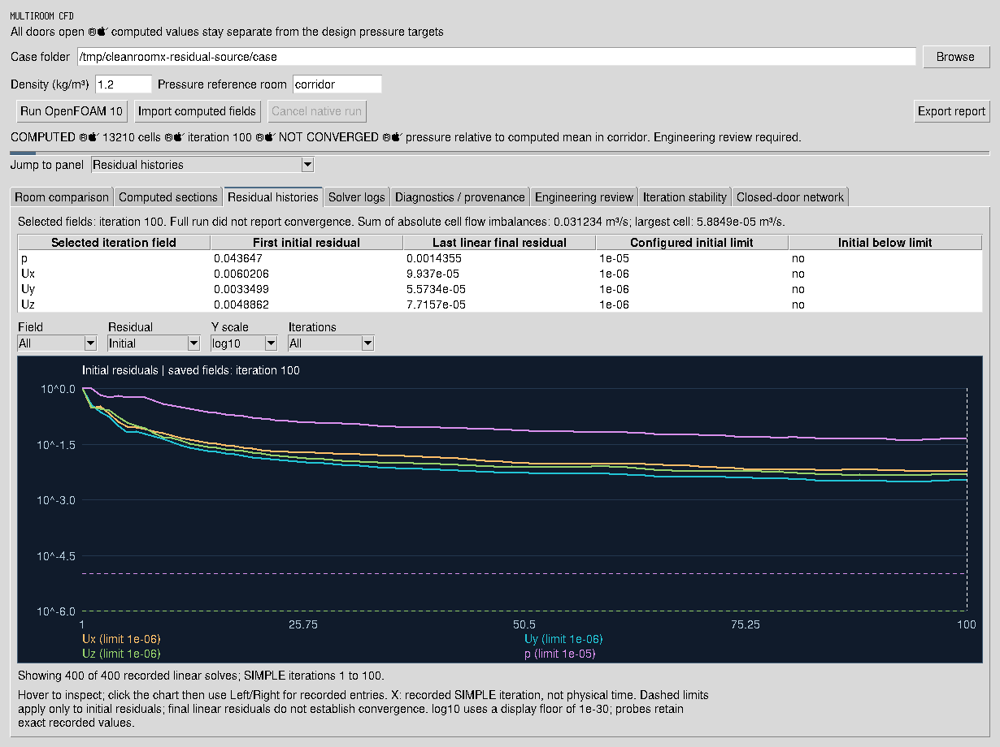
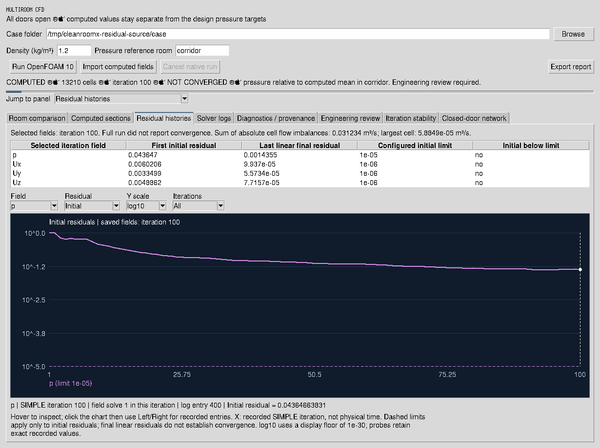
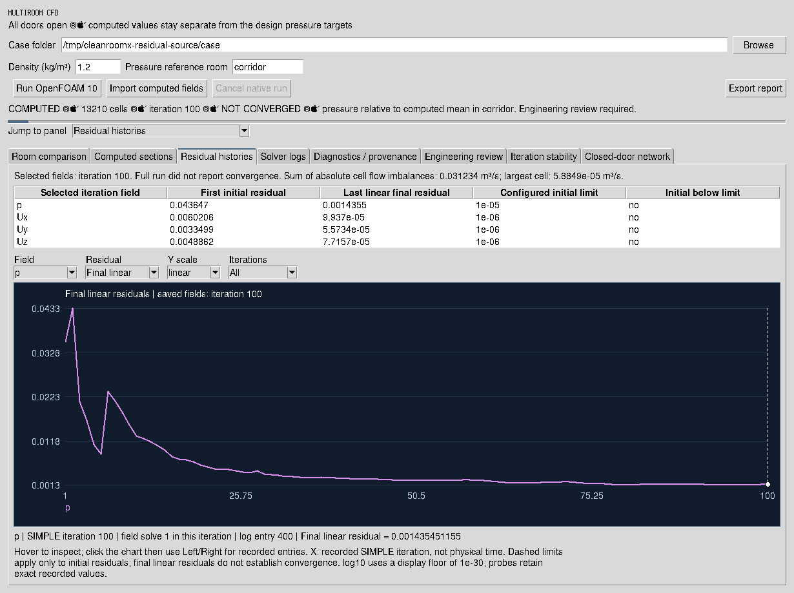

# Native residual inspection — 21 October 2026

The existing **Residual histories** panel now has real Tk controls for field,
initial/final linear residual, linear/log10 scale and the last 100/500 distinct
recorded SIMPLE iterations. Hover shows the actual entry. Click the chart and
use Left/Right to inspect entries in original log order, including multiple
linear solves for the same field and iteration. No residuals are averaged,
interpolated or converted into physical time.

The initial view shows configured per-field initial residual limits. The
**Final linear** view does not apply those limits. The saved-field marker is
hidden, with an explicit caption, when its iteration is outside the visible
range. Exact zeros retain their recorded values in probes; log10 uses an
explicit display floor of 1e-30. Display filters never change the imported
report, solver verdict or engineering review. The existing **Export report**
action still exports the complete recorded history to `residuals.csv`.

## Actual application captures

These are pixels from the running Tk application on Xvfb, using the original
[archived reproduction case](../../reports/engineering-session-20261021/reproduction-case.tar.gz).
The canonical importer rechecked its inputs, execution receipt, logs, mesh and
recorded fields. It contains **13,210 cells**, **100 recorded SIMPLE iterations**
and **400 linear-solver residual entries**. The selected fields are at iteration
100. This historical design-flow run **did not report convergence**.







[Capture manifest](capture-manifest.json) records the image, implementation,
log, input and receipt hashes; active controls; exact inspected values; and
zero Tk callback errors. The source report was reimported after the captures
and its plotted data compared with the original imported report.

Reproduce on a real display after extracting the archived case:

```bash
PYTHONPATH=src python scripts/capture_residual_inspection_gui.py \
  /path/to/extracted/case /path/to/new-capture-directory
```

No new solver execution is claimed. The synthetic regression logs test
repeated solves, iteration gaps, exact zeros and invalid inputs; they are
separate from these actual recorded-data captures. Closed-door 5 Pa behavior,
mesh independence and physical particle qualification remain unvalidated.
**Engineering release remains HOLD.**
