# CleanroomX — Real GUI and OpenFOAM gallery

**21 October 2026 · 17 archived PNG files · Development evidence, not a stable-release qualification.**

These files were captured from the actual CleanroomX Tk/VTK application on the development branch in [PR #1363](https://github.com/3more102/CleanroomX-Cleanroom-Design-Simulation-Verification-Platform/pull/1363). Solver-derived displays use an actual OpenFOAM Foundation v10 **all-doors-open** case at saved SIMPLE iteration **100**. **That case did not converge. Engineering release: HOLD.** Design arrows and target pressures are inputs, not CFD predictions. The particle visualizations are bounded numerical screening, not validated contamination measurements.

Use the PNG links below to open the full-resolution originals. The source capture [manifest](https://github.com/3more102/CleanroomX-Cleanroom-Design-Simulation-Verification-Platform/blob/4d2b326a66256bfeaf7b2a430c6895647be476d3/reports/engineering-session-20261021/capture-manifest.json), [engineering report](https://github.com/3more102/CleanroomX-Cleanroom-Design-Simulation-Verification-Platform/blob/4d2b326a66256bfeaf7b2a430c6895647be476d3/reports/engineering-session-20261021/REPORT.md), and [capture script](https://github.com/3more102/CleanroomX-Cleanroom-Design-Simulation-Verification-Platform/blob/4d2b326a66256bfeaf7b2a430c6895647be476d3/scripts/capture_recorded_cfd_gui.py) remain on the integration commit; copying the images into `main` does **not** merge experimental solver code.

## Design and 3D workspaces

| [**01-main-workspace.png**](01-main-workspace.png) | [**02-design-studio.png**](02-design-studio.png) | 
| :--: | :--: |
| 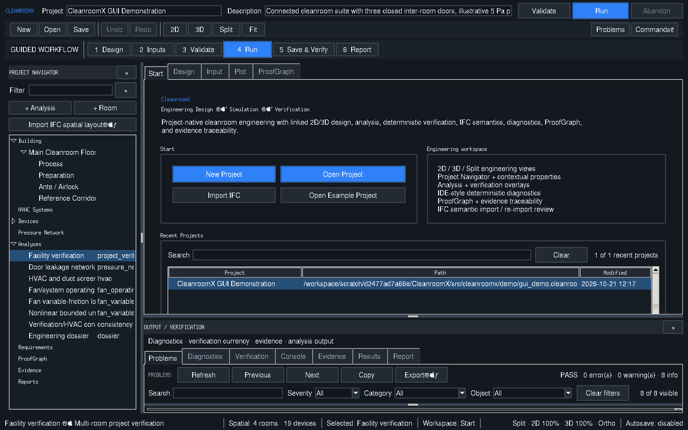 | 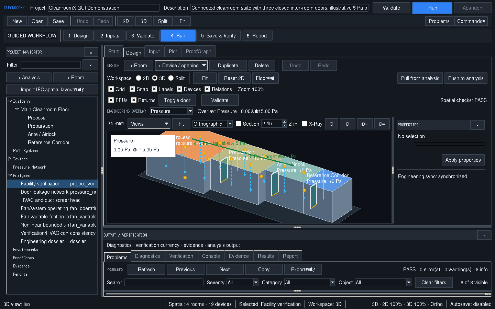 |
| Running CleanroomX start workspace with the bundled input project | Actual 3D design geometry; design arrows/pressure intent are not CFD fields |

| [**03-multiroom-design.png**](03-multiroom-design.png) | [**04-object-inspector.png**](04-object-inspector.png) | 
| :--: | :--: |
| 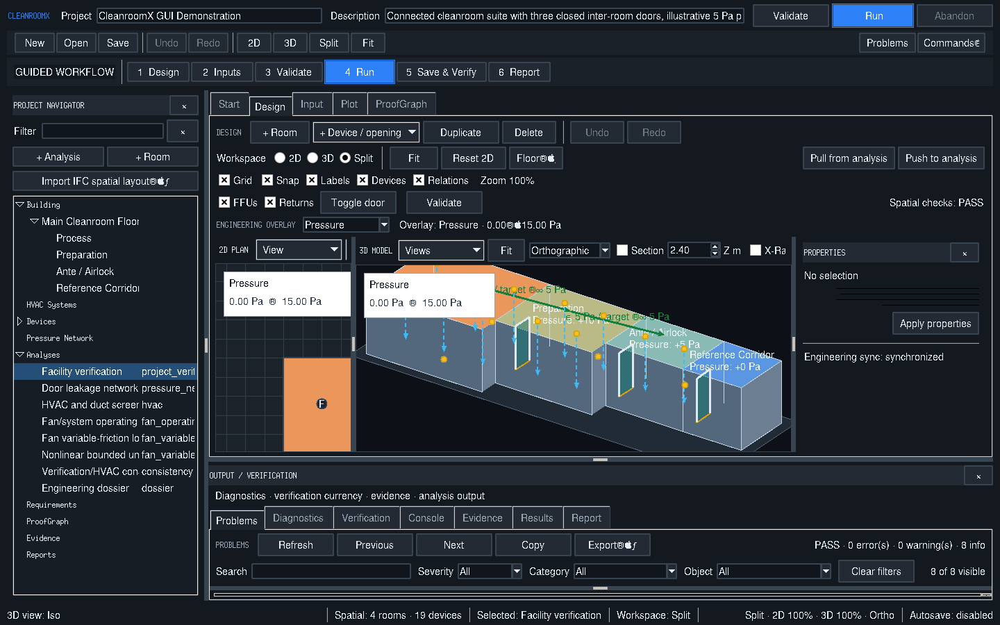 |  |
| Synchronized actual 2D/3D multiroom input geometry | Actual selected-room property inspector |

## Recorded OpenFOAM mesh and CFD fields

| [**05-simulation-workspace.png**](05-simulation-workspace.png) | [**06-original-openfoam-mesh.png**](06-original-openfoam-mesh.png) | 
| :--: | :--: |
|  |  |
| Real imported OpenFOAM room/door p and phi review; nonconvergence/HOLD retained | Original verified polyMesh cell edges on the selected recorded z layer |

| [**07-computed-velocity-section.png**](07-computed-velocity-section.png) | [**08-pressure-and-airflow.png**](08-pressure-and-airflow.png) | 
| :--: | :--: |
| 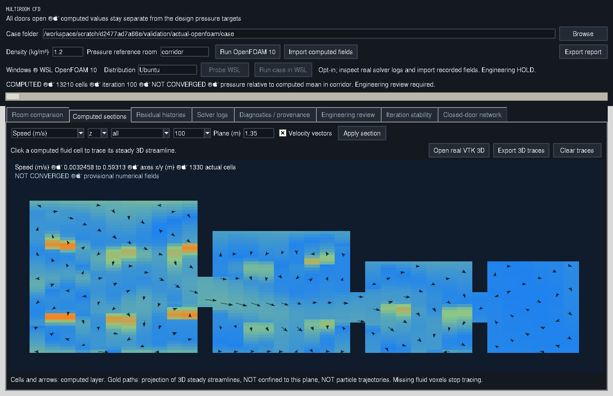 | 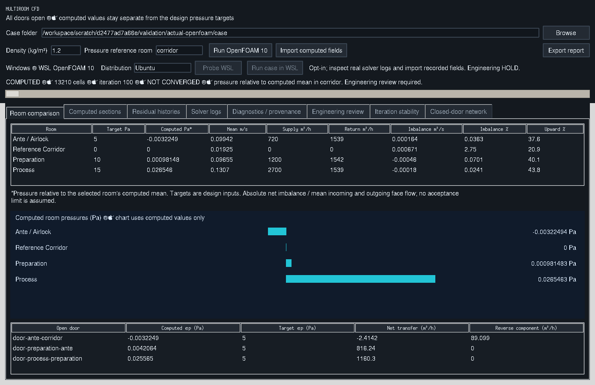 |
| Actual recorded cell velocity magnitudes/vectors on a z layer; no interpolated cells | Computed room pressures, door deltas and face-flux airflow balances |

## Particle sources and tracking

| [**09-particle-injection.png**](09-particle-injection.png) | [**10-computed-particle-tracking.png**](10-computed-particle-tracking.png) | 
| :--: | :--: |
|  | 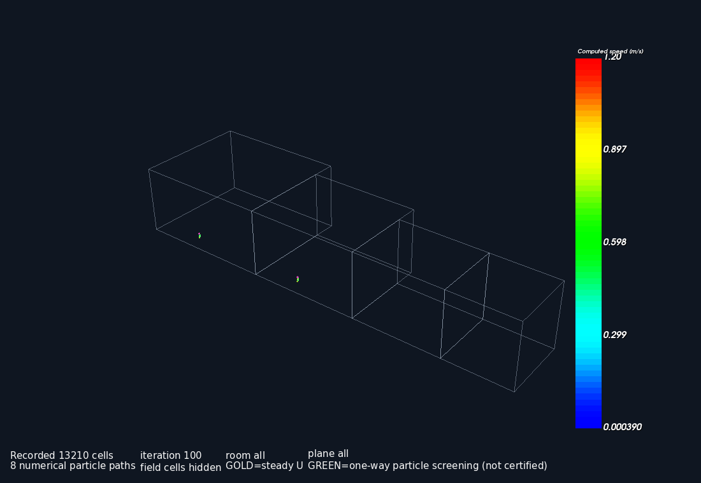 |
| Actual source editor with two saved fluid sources, diameter/density/count and release schedules | Actual integrated particle paths and release-aware recorded-sample markers in computed 3D U |

## Solver and numerical analysis

| [**11-residual-graphs.png**](11-residual-graphs.png) | [**12-iteration-analysis.png**](12-iteration-analysis.png) | 
| :--: | :--: |
| 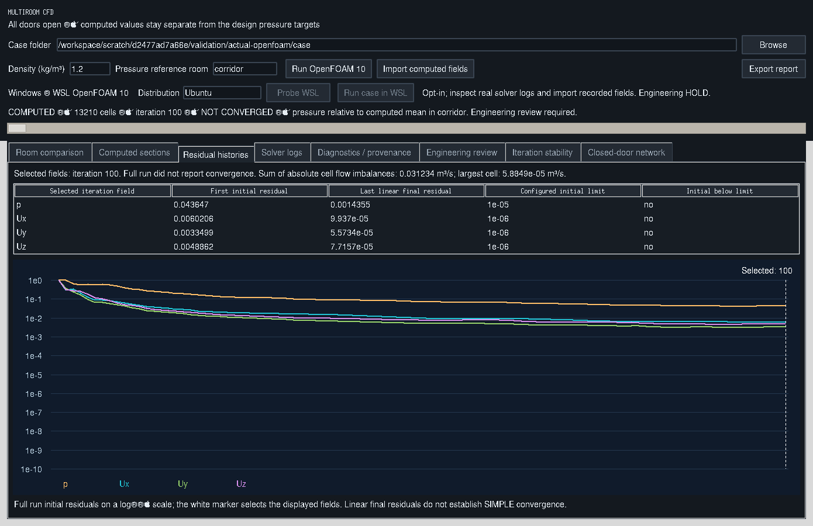 | 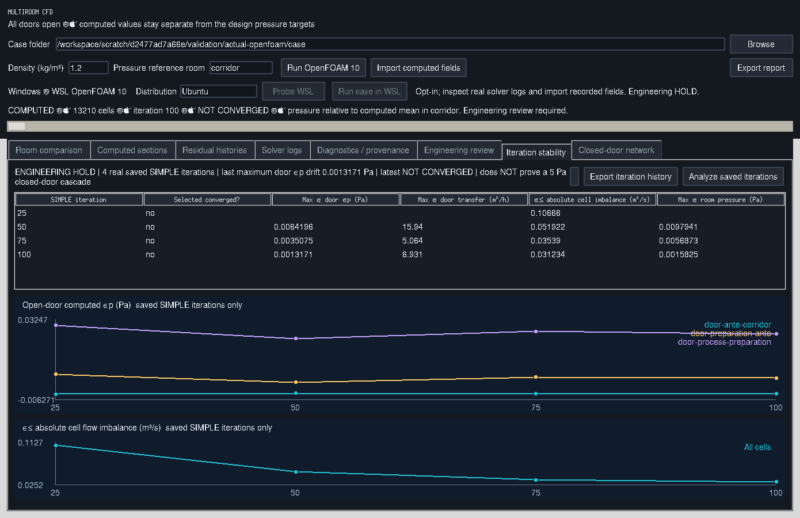 |
| Actual saved solver initial/final residual histories | Actual saved SIMPLE pressure/continuity observations; iteration is not physical time |

| [**13-particle-population.png**](13-particle-population.png) | 
| :--: |
|  |
| Computed numerical particle population chart/table from eight scheduled frozen-U trajectories |

## Native 3D review

| [**14-3d-review-controls.png**](14-3d-review-controls.png) | [**15-computed-3d-velocity.png**](15-computed-3d-velocity.png) | 
| :--: | :--: |
| 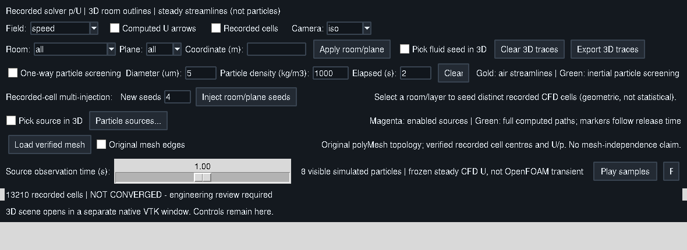 | 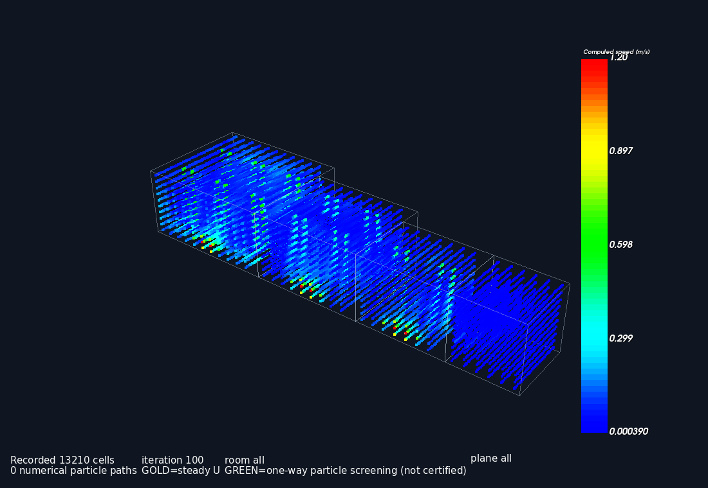 |
| Actual 3D field/source/mesh and particle playback controls | Actual recorded 3D velocity samples with isometric camera; no interpolated volume field |

| [**16-computed-3d-pressure.png**](16-computed-3d-pressure.png) | [**17-particle-source-closeup.png**](17-particle-source-closeup.png) | 
| :--: | :--: |
| 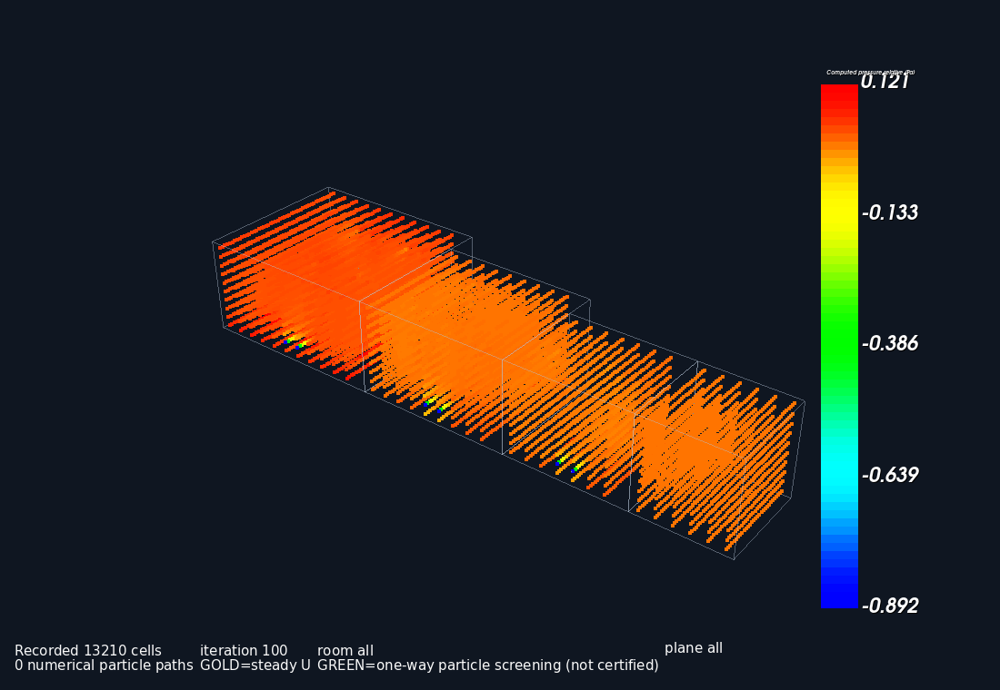 |  |
| Actual recorded 3D relative pressure samples in Pa, using explicit density/reference | Actual camera close-up of computed process-source paths; no trajectory scaling or synthetic motion |

**Evidence note:** `05-simulation-workspace.png` and `08-pressure-and-airflow.png` have the same Git blob SHA and are **identical bytes** in the archived capture set. Both original file names are retained for traceability; these are **17 files, 16 distinct images**. No image has been replaced by a synthetic or fabricated CFD view.

For the current development status, inspect [PR #1363](https://github.com/3more102/CleanroomX-Cleanroom-Design-Simulation-Verification-Platform/pull/1363). The latest branch's live CFD validation state may differ from this dated screenshot archive.
