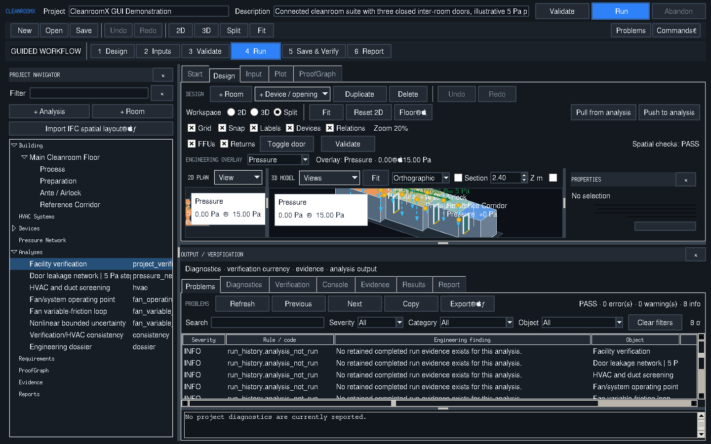
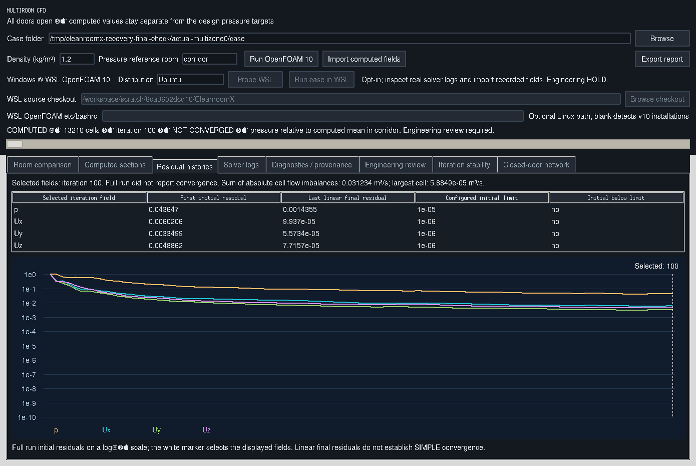

# Actual desktop recovery captures — 21 October 2026

Captured from the running application by
`scripts/capture_startup_recovery_gui.py`. The manifest records image SHA-256,
dimensions, the exact imported solver receipt and zero Tk callback errors.
The original executed case is retained in the
[milestone evidence](../../reports/startup-runtime-recovery-20261021/REPORT.md).

The Linux display has minimal Tk font-rendering limitations. WSL controls are
disabled on Linux; these captures are not Windows execution evidence. The
OpenFOAM case remains unconverged and engineering release is **HOLD**.

