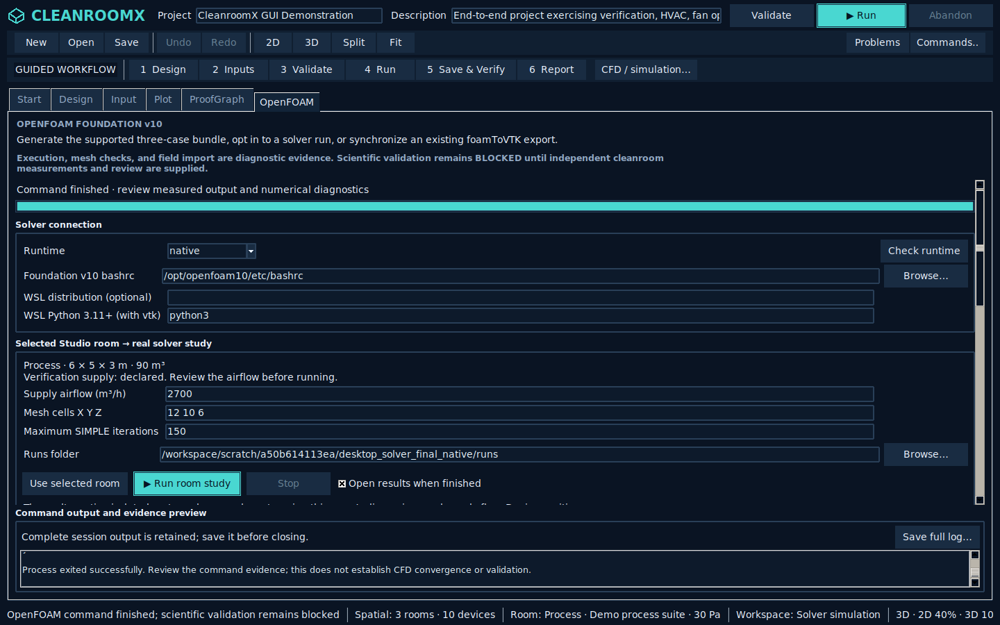
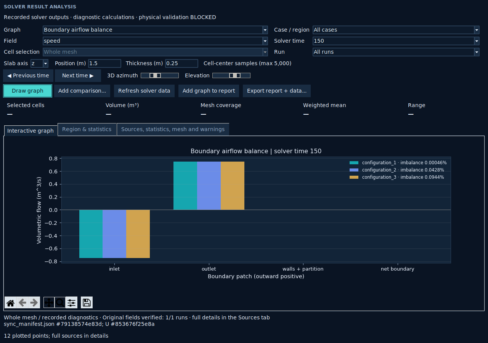
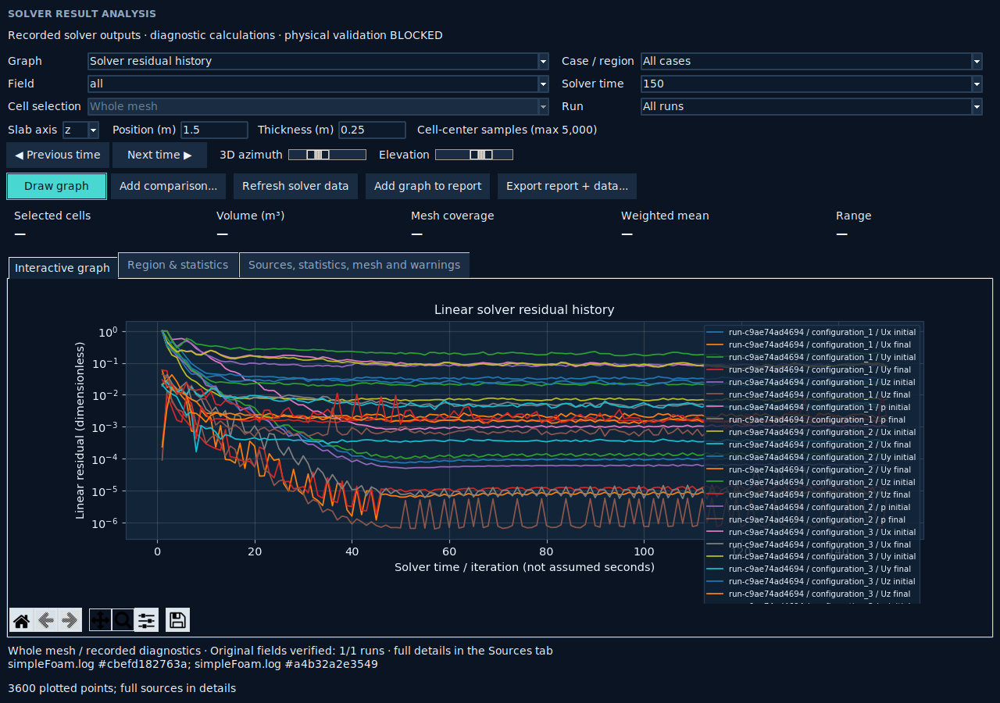

# Actual desktop-to-solver execution — 19 October 2026

The actual Tk **Run room study** button launched OpenFOAM Foundation v10, synchronized its output and opened the result explorer automatically. No solver mocks were used.

Source: `173f3ff533bf4f8573f6bcd2c7a2a4d997095792`, tree `4cd940125df007a655f90255a7e89c99645c2479`.

- 3 cases, 720 cells each; 9 blockMesh/checkMesh/simpleFoam stages completed.
- 9 recorded field snapshots; original U, p and phi bytes rehashed.
- Boundary flux, whole-domain supply ACH, residuals and field-history graphs exported.
- Altered generated input, native pressure, boundary geometry and solver log were each rejected, then their original bytes restored.
- 2,838 full-suite tests passed; one optional native IFC dependency skip. All 258 focused desktop cases executed and passed without skips.
- Linux solver execution was performed. Actual Windows/WSL solver execution was not performed locally.

The idealized 6 × 5 × 3 m room uses 2,700 m³/h supply. Measured final flow imbalance is approximately 0.000460%, 0.042821% and 0.094371% for configurations 1, 2 and 3. No project acceptance threshold was applied. Supply ACH is calculated from solver inlet phi and verified VTK mesh volume.

These are diagnostic integration results. Device positions, obstructions and inter-room connections are not meshed in this room study; turbulence, heat, contaminant and particle transport are not solved. Solver convergence, mesh independence and physical cleanroom validation remain unestablished.

The [native evidence archive](native-solver-evidence.zip) retains the exact generated cases, native fields, logs, sync receipts, project snapshot and exported analysis. File and source hashes are recorded in [validation.json](validation.json) and [verification.json](verification.json). CI runs the same desktop-to-solver script and publishes complete execution artifacts.
