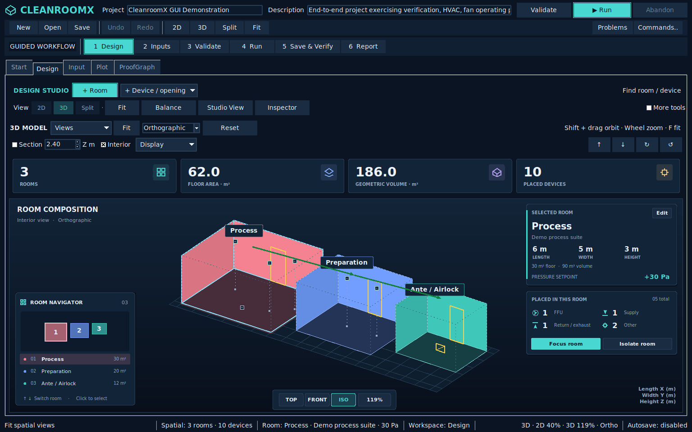

# Design Studio visual refinement — 19 October 2026

Actual desktop captures of the published source
`431688e88e13fe6444669999a293fcea9522c47c`, tree
`1b0e17539cd897218e33da9684c35a77c962f851`.

- [1280 × 800](design_studio_1280x800.png)
- [1536 × 960](design_studio_1536x960.png)
- [1920 × 1080](design_studio_1920x1080.png)

The update adds rounded metric/detail cards, native vector icons and branding,
segmented view controls, a floating navigator/camera dock, subtle categorical
wall shading and selection outlines. Actions have hover feedback; camera buttons
reflect the actual view. Edit, Focus and Isolate operate on the selected room or
the assigned room of a selected device.

Each PNG has a JSON receipt recording its source-file fingerprints, screenshot
hash, window dimensions and model counts. `verification.json` records desktop
and full-regression results. `desktop.xml` and `regression.xml` preserve their
JUnit evidence. Current Windows/Linux CI results are linked from PR #1354.

Launch from the updated branch with `cleanroomx-gui --demo`.
